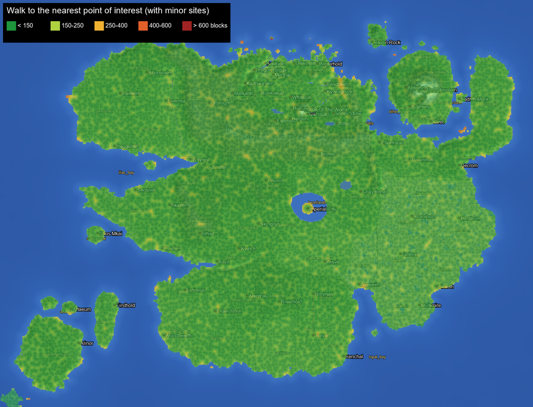
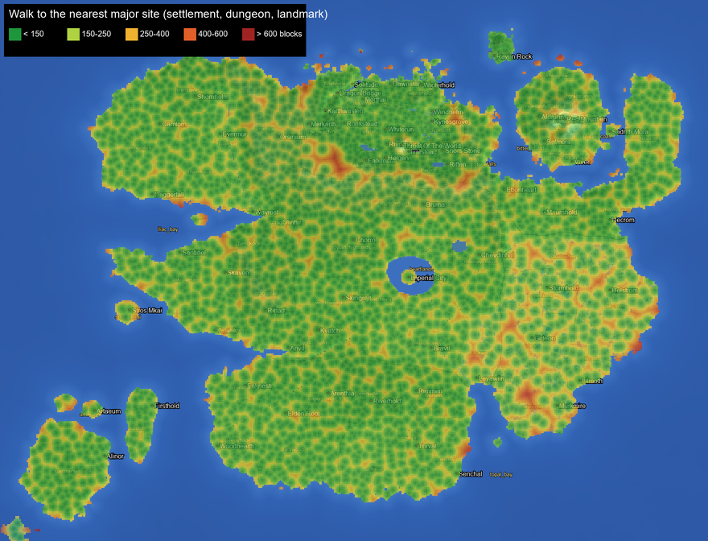

# Exploration: something worth finding every few minutes

In Skyrim you rarely walk more than a minute or two without spotting something: a camp's smoke, a shrine by the
road, a cairn on a ridge, a corpse with a note in its pack. This file describes how Skycraft makes all of Nirn that
dense, and how it measures that it is. The code is in `com.skycraft.explore`. The tools are in `tools/explore/`.

## 1. The targets

These are measured at walking speed, about 4.3 blocks a second.

| What | Target | Walking time |
| --- | --- | --- |
| A **notable point of interest** (any settlement, dungeon, landmark, minor site or site feature) | within **150–250 blocks** almost everywhere: at least 90% of land points within 250 | about 35–60 s |
| A **major site** (a settlement, dungeon or landmark: what Skyrim marks on the map) | within **600 blocks**: at least 90% of land points | about 2.5 min |

Open sea is not counted. Every land sample point is attributed to the region it lies in.

## 2. The density audit

### In game

`/skycraft-explore audit [regions|tamriel|all] [perRegion] [realms]` needs op level 2. It runs on a background
thread and writes CSV files to `<server>/skycraft-explore/`.

The areas it samples:

* **regions**: `perRegion` areas of 2048×2048 blocks (default 2) in every authored land region. They are spread out
  by farthest-point sampling over the region's land cells. The fixed foreign lands are added (Atmora, Akavir,
  Tang Mo, Yokuda, the Sunken Isles, Pyandonea, Thras), plus `realms` landmasses of the endless lands (default 8).
* **tamriel**: every 2048-block tile of the Tamriel raster that has any land. This mode feeds the heatmaps.

The points of interest come from deterministic placement only. Nothing is generated:

* **Named places**: every entry in `skycraft/tamriel/places/*`.
* **Random-spread structure sets**: the exact vanilla placement math. That covers `getPotentialStructureChunk`, the
  exclusion zones and the weighted try-in-turn choice. Each candidate is then checked with the structure's own
  `findValidGenerationPoint`. That check is the same one the game runs, which covers culture `where` filters, named
  places, town exclusion and ground flatness. It reads noise heights only.
* **Minor sites**: `MinorSites.at` for every cell. A site is dropped if the real terrain at its centre is water, or
  if a surface structure starts within 40 blocks of it.
* **Site features**: the rarity-filtered features, which are wayside shrines, bandit camps and shrine features. They
  are estimated as a seeded per-chunk Bernoulli trial from their `rarity_filter`, the biome's feature list at that
  chunk, and an assumed pass rate for their own ground checks (35–50%).
* **Forage patches**: the expected patches per km², from every forage feature in the biome at each sample point.
* **Encounters per km walked**: one wilderness roll every ~270 s, about 85% of which find a spawn spot (society
  `Encounters`). Road travellers add about one group every 40 s along roads, about half of which spawn.

Each land sample point lies on a 32-block grid. For each one the audit records the distance to the nearest point of
interest counted three ways:

* **Before**: named places and structures only. This is what the world offered without this module.
* **After**: named places, structures and minor sites. The verdict is judged on this figure.
* **With features**: all of the above plus the estimated site features. It is reported, but not relied on, because
  those features' ground-check pass rates are guesses.

It also records the distance to the nearest major site.

Vanilla structures are left out. The buried ones (mineshafts, strongholds, ancient cities, buried treasure, ocean
ruins) are never seen from the surface. The visible ones (ruined portals, pillager outposts) still generate in
Skycraft's biomes, but they are not Skyrim content.

### Offline

`py -3 tools/explore/density_audit.py estimate --seed 1234` is a map-only estimate for the Tamriel raster that needs
no game. It uses the same placement math, ported to Python: Java's LCG, `setLargeFeatureWithSalt` and the minor-site
SplitMix hash. It reads named places, the structure sets' culture filters, and the map's land and water.

It cannot see terrain flatness or biomes, so it overestimates the random structures. Use the in-game audit as the
reference.

### The report

`py -3 tools/explore/density_audit.py render` reads the in-game CSVs and writes:

* the heatmaps below;
* `docs/exploration/density.csv`;
* the region table in section 5.

## 3. Minor sites

Minor sites are Skyrim's unmarked locations. The world is cut into 160-block cells, and each cell holds at most one
site. The site sits at a hashed chunk well inside its cell, so neighbouring sites stay at least four chunks apart.
The share of occupied cells depends on the province:

| Area | Share of cells occupied |
| --- | --- |
| Skyrim | 45%, since its 430 named places already crowd the land |
| Solstheim | 50% |
| Black Marsh | 70%, since it has the fewest towns and roads |
| The other provinces, the foreign lands and the realms | 60% |

These shares were tuned with the audit (section 5). The first pass used 60% for Skyrim and 80% elsewhere. That put a
point of interest within about 115 blocks of 90% of the land, denser than Skyrim needs, so the shares were lowered.

That share is scaled by `density` in `config/skycraft-explore.toml`.

The kind of site is a weighted choice from the map context of the spot:

* the region's culture and province, and a realm's archetype;
* coast, and lake or river shores;
* height over the surroundings, mountains, and cold.

Every site has a chest or barrel, with loot tables under `loot_tables/explore/`. Gear comes from Skycraft's leveled
and regional functions, and ingredients are regional. Most sites can also hold a short note telling their story.

| Kind | Where | What you find |
| --- | --- | --- |
| Abandoned camp | everywhere | torn tent, cold fire, a journal (6 stories), sometimes a treasure map or a lead note |
| Hunter's camp | everywhere | hide tent, **smoking fire**, drying rack, pelts and arrows; half have a hunter living there |
| Wayshrine | lands of the Nine, roadsides favoured | stepped platform, the Divine's shrine (blessings work), **banners in the Divine's colour**, offerings |
| Treasure cache | everywhere | a small cairn over a chest buried 3 deep; treasure maps lead to these |
| Fallen adventurer | everywhere | skull and bones, their **real leveled weapon lying beside them**, their pack |
| Overgrown herb garden | everywhere | fenced beds of regional herbs (nightshade, deathbell…), brewing stand, scarecrow |
| Rare reagents | everywhere | a giant's grave (giant's toe) in the north, a fire-salt vent in Morrowind and Hammerfell, otherwise a glowing pool with nirnroot |
| Stone circle | everywhere | ring of standing stones, an altar with candles |
| Ancient battlefield | everywhere | weapons and bones strewn about, armour stands of the fallen, tattered standards, a war chest |
| Ruined mage tower | everywhere | broken round tower, lectern, shelves, a cold summoning circle, spell tomes; more skill books |
| Hermit's hut | everywhere | log hut with a **smoking chimney**, bedroll, brewing stand; a hermit (hunter or apothecary) moves in |
| Bandit lookout | high ground favoured | wooden tower with ladder, **black banner**, a smoking fire, 1–2 bandits, their take |
| Overlook | high ground only | flagstone landing, bench, a brazier and a banner pole, a spyglass, a traveller's satchel |
| Exposed vein | mountains favoured | rock outcrop with regional Skycraft ore showing on its faces, a pick, a prospector's barrel |
| Shipwreck debris | coasts | broken hull, snapped mast, torn sail, barrels and a chest along the beach |
| Fishing dock | lake and river shores (some coasts) | plank dock on log piles, lantern, rod and barrel; a fisher's camp when no water is close |
| Hot spring | cold regions | steaming basin (magma below, **smoke vents**), a bather's things |
| Dwemer vent | Skyrim, Morrowind, Hammerfell, High Rock | copper pipes, a grated shaft breathing steam, a sealed hatch, Dwemer scrap; sometimes a dormant spider |
| Nordic cairn | Skyrim, Atmora, Solstheim, cold realms | burial mound with marker, urn and candles; sometimes a dormant draugr |
| Ayleid well | Cyrodiil (also Valenwood, High Rock, temperate realms) | white dais with a **glowing welkynd stone** (restores all magicka, once a day) and four glowing lesser stones |
| Velothi wayshrine | Morrowind, ash realms | domed shrine on columns, an ancestor's urn, candles, a prayer slip |
| Hist sapling | Black Marsh, swamp realms | a young Hist ringed by water, sap seeping from the bark, offerings |
| Moon sugar field | Elsweyr, savanna realms | irrigated cane rows and a Khajiit cart with the harvest (moon sugar and skooma) |
| Giant beehive | Valenwood, jungle realms | an old tree with a hanging mass of comb, honey, and bees |
| Crystal outcrop | Summerset, crystal realms | **glowing** crystal spires on calcite, amethyst, a gem-cutter's cache |
| Yokudan obelisk | Hammerfell, Yokuda, desert realms | sandstone obelisk with glyph bands and a **gold cap**, an offering buried in the dais |
| Breton menhir | High Rock, temperate realms | tall carved stone, a ring of low stones, an offering at its foot |
| Akaviri shrine | Akavir | small pagoda shrine, serpent idol lantern, incense |
| Shrine of the Deep | Pyandonea, Thras | prismarine circle, glowing column topped with a conduit |
| Uncharted monolith | the endless realms | black monolith veined with crying obsidian, glowing, with a riddle |

How sites stay well behaved:

* **Cheap and safe.** Sites are built by one feature, `skycraft:minor_site`. It is placed once per chunk in every
  overworld biome at `top_layer_modification`, after the trees, and writes only inside the 3×3 chunks it owns.
* **Clear of named places.** Sites keep 40 blocks clear of every named place's radius.
* **Clear of surface structures.** A site gives way to any surface structure with a piece over its chunk.
* **No water or cliffs.** A site refuses water, and refuses cliffs (spread over 8–12 blocks) in its builder.
* **Exceptions.** Treasure caches and unique sites are always built, because maps and notes point to them.
* **Same answer everywhere.** The placement depends only on the seed and the Tamriel map. The feature, the audit,
  treasure maps, the "Found" check and the offline script therefore always agree.

## 4. Exploration hooks

* **Spottable from afar.** Hunters' camps, hermits' chimneys, bandit lookouts, hot springs, Dwemer vents and
  fire-salt vents have signal-fire smoke columns. Ayleid wells, crystal outcrops, sea shrines and monoliths glow.
  Wayshrines, lookouts, overlooks and battlefields fly banners. Obelisks are gold-capped.
* **Discovery experience** (configurable in `skycraft-explore.toml`; Skyrim gives none):
  * `discoveryXp` (default 6): Athletics skill-use XP for a newly discovered named place or dungeon. It is hooked in
    `world/Discovery`.
  * `minorSiteXp` (default 2): Athletics XP for the first time you come upon a minor site. A quiet "Found: Hunter's
    Camp" line shows; turn it off with `foundMessages`.
* **Skill books in the wild.**
  * Explore loot tables add one skill book 3–12% of the time, 22% at mage towers, plus skill-specific books at
    hunters', fishers', miners' and herbalists' sites.
  * Skycraft's own dungeon chests skip the generic chest modifiers, so the `skycraft:explore_skill_books` global loot
    modifier adds a skill book to 6% of common, minor, Dwemer, giant, dragon and bandit chests, and to 30% of boss
    chests.
* **Treasure maps.**
  * Abandoned camps, adventurers' packs, overlooks, lookouts, wrecks and monoliths sometimes hold a treasure map. It
    points to the nearest treasure cache within 1,600 blocks, other than the chest's own site.
  * Using the map opens a hand-drawn sketch of the area made from the Tamriel map: coasts, lakes and rivers, height
    lines, roads, named places, a compass and a red X.
  * With `treasureMapMarkers` on (the default), the map also marks the spot on the world map. The marker clears when
    you reach the cairn.
* **Notes that lead to places.**
  * Six "lead" notes record where they were found: bandit orders, a scholar's letter, a hunter's tally, a courier's
    rumours, a smuggler's note, and a dying adventurer's scrap.
  * Reading one marks the nearest location you don't yet know to that spot (`Discovery.revealNear`), once per
    reader.
* **Unique items.**
  * 33 named uniques are hidden once per world at fixed minor sites across every province and the foreign lands,
    each with a lore line and 12 with a note telling their story.
  * Their positions are picked by `tools/explore/gen_explore_data.py` on dry land well away from named places.
  * They are all original and don't duplicate the arsenal artifacts. `/skycraft-explore uniques` lists them.

## 5. Results

The table below is filled by `density_audit.py render` (seed 1234, perRegion 2, all of Tamriel tiled).

The column groups are:

* **Before** and **After** give the median and 90th-percentile distance in blocks to the nearest point of interest,
  and the share of land within 250 blocks of one. Before is named places and structures only; after adds the minor
  sites. "Walk p90" is the 90th percentile at 4.3 blocks a second.
* **With features** also counts the estimated wayside shrines and bandit-camp features.
* **Major ≤600** is the share of land within 600 blocks of a settlement, dungeon or landmark.
* **Verdict** is `ok` when after ≥ 90% and major ≥ 90%.
* The per-km² columns count the points of interest standing in the sampled areas.

<!-- AUDIT:BEGIN -->
| Region | Land km² | Settl./km² | Dung./km² | Landm./km² | Minor/km² | Feat./km² | Forage/km² | Enc./km | Before: p50 / p90, ≤250 | After: p50 / p90 (walk p90), ≤250 | With features ≤250 | Major ≤600 | Verdict |
|---|---:|---:|---:|---:|---:|---:|---:|---:|---|---|---:|---:|---|
| akavir/ka_po_tun | 9.9 | 4.8 | 6.9 | 0.0 | 23.9 | 5.9 | 1 | 0.73 | 132 / 227, 95% | 73 / 126 (29 s), 100% | 100% | 100% | ok |
| akavir/kamal | 3.4 | 4.4 | 5.9 | 0.0 | 24.8 | 13.0 | 646 | 0.73 | 140 / 233, 94% | 74 / 124 (29 s), 100% | 100% | 100% | ok |
| akavir/tang_mo | 0.4 | 10.0 | 2.5 | 0.0 | 32.6 | 5.0 | 0 | 0.73 | 126 / 270, 88% | 69 / 125 (29 s), 100% | 100% | 100% | ok |
| akavir/tsaesci | 2.4 | 5.5 | 3.8 | 0.0 | 23.6 | 5.1 | 14 | 0.73 | 149 / 248, 91% | 76 / 130 (30 s), 100% | 100% | 100% | ok |
| atmora/frozen_forest | 5.7 | 3.7 | 6.2 | 0.0 | 22.1 | 13.4 | 1193 | 0.73 | 141 / 234, 94% | 76 / 131 (30 s), 100% | 100% | 100% | ok |
| atmora/ice_waste | 2.7 | 6.2 | 5.9 | 0.0 | 22.4 | 14.7 | 663 | 0.73 | 129 / 217, 96% | 74 / 127 (30 s), 100% | 100% | 100% | ok |
| black_marsh/gideon | 7.0 | 1.4 | 4.4 | 0.0 | 27.2 | 8.3 | 13887 | 0.73 | 194 / 355, 69% | 74 / 128 (30 s), 100% | 100% | 100% | ok |
| black_marsh/helstrom | 10.8 | 1.1 | 4.3 | 0.0 | 25.8 | 5.5 | 15702 | 0.73 | 194 / 347, 71% | 76 / 131 (30 s), 100% | 100% | 100% | ok |
| black_marsh/lilmoth | 4.2 | 0.7 | 4.7 | 0.0 | 26.5 | 7.1 | 15282 | 0.73 | 184 / 327, 74% | 75 / 129 (30 s), 100% | 100% | 99% | ok |
| black_marsh/murkmire | 4.6 | 0.4 | 4.8 | 0.0 | 28.2 | 7.0 | 13694 | 0.73 | 204 / 398, 64% | 72 / 122 (28 s), 100% | 100% | 99% | ok |
| black_marsh/shadowfen | 7.3 | 1.1 | 5.1 | 0.7 | 25.7 | 5.6 | 17563 | 0.75 | 171 / 309, 77% | 74 / 126 (29 s), 100% | 100% | 100% | ok |
| black_marsh/stormhold | 7.0 | 1.0 | 4.7 | 0.6 | 28.0 | 3.6 | 14498 | 0.73 | 168 / 261, 87% | 72 / 123 (29 s), 100% | 100% | 100% | ok |
| cyrodiil/blackwood | 5.2 | 1.9 | 4.2 | 0.2 | 23.9 | 2.7 | 16896 | 0.76 | 168 / 296, 81% | 77 / 130 (30 s), 100% | 100% | 100% | ok |
| cyrodiil/colovian_highlands | 11.6 | 4.8 | 5.7 | 0.2 | 23.8 | 7.1 | 116 | 0.75 | 142 / 249, 90% | 75 / 134 (31 s), 100% | 100% | 100% | ok |
| cyrodiil/gold_coast | 7.9 | 4.9 | 5.6 | 0.4 | 22.1 | 7.5 | 11676 | 0.81 | 136 / 233, 94% | 75 / 132 (31 s), 100% | 100% | 100% | ok |
| cyrodiil/great_forest | 5.4 | 3.9 | 5.0 | 0.4 | 20.7 | 7.6 | 1466 | 0.82 | 138 / 220, 95% | 79 / 136 (32 s), 100% | 100% | 100% | ok |
| cyrodiil/heartlands | 6.5 | 4.1 | 5.0 | 0.1 | 22.3 | 6.4 | 2032 | 0.88 | 149 / 274, 85% | 77 / 151 (35 s), 98% | 99% | 100% | ok |
| cyrodiil/jerall_mountains | 9.0 | 3.8 | 6.1 | 0.6 | 23.6 | 5.9 | 591 | 0.76 | 136 / 232, 93% | 74 / 132 (31 s), 100% | 100% | 100% | ok |
| cyrodiil/nibenay_basin | 9.7 | 5.1 | 6.0 | 0.2 | 20.7 | 6.0 | 3144 | 0.79 | 136 / 233, 94% | 77 / 138 (32 s), 100% | 100% | 100% | ok |
| cyrodiil/nibenay_valley | 11.7 | 4.4 | 6.0 | 0.4 | 21.8 | 6.6 | 21460 | 0.78 | 136 / 229, 94% | 76 / 136 (32 s), 100% | 100% | 100% | ok |
| cyrodiil/west_weald | 5.4 | 4.8 | 5.2 | 0.9 | 23.7 | 5.2 | 9484 | 0.80 | 126 / 212, 97% | 73 / 126 (29 s), 100% | 100% | 100% | ok |
| elsweyr/anequina | 12.0 | 4.8 | 6.6 | 0.3 | 19.4 | 6.2 | 109 | 0.73 | 126 / 213, 97% | 77 / 138 (32 s), 100% | 100% | 100% | ok |
| elsweyr/pellitine | 9.6 | 5.4 | 6.5 | 0.0 | 24.5 | 4.3 | 4511 | 0.73 | 132 / 220, 95% | 72 / 126 (29 s), 100% | 100% | 100% | ok |
| elsweyr/rimmen | 5.6 | 4.5 | 5.7 | 0.7 | 22.1 | 3.2 | 10874 | 0.85 | 140 / 239, 92% | 75 / 126 (29 s), 100% | 100% | 100% | ok |
| elsweyr/senchal | 4.6 | 2.6 | 5.5 | 1.5 | 21.2 | 7.0 | 12181 | 0.79 | 154 / 291, 82% | 78 / 149 (35 s), 100% | 100% | 100% | ok |
| elsweyr/torval | 6.0 | 4.0 | 6.5 | 1.7 | 21.1 | 5.2 | 11732 | 0.87 | 126 / 216, 97% | 76 / 139 (32 s), 100% | 100% | 100% | ok |
| hammerfell/alikr_desert | 7.9 | 4.5 | 6.6 | 0.5 | 19.7 | 5.7 | 13 | 0.77 | 136 / 235, 92% | 79 / 143 (33 s), 100% | 100% | 100% | ok |
| hammerfell/bangkorai | 5.4 | 3.1 | 8.3 | 0.7 | 14.6 | 3.9 | 53 | 0.87 | 132 / 255, 89% | 86 / 153 (36 s), 100% | 100% | 100% | ok |
| hammerfell/craglorn | 4.6 | 2.2 | 4.0 | 0.9 | 19.1 | 6.1 | 4 | 0.77 | 154 / 258, 88% | 82 / 141 (33 s), 100% | 100% | 100% | ok |
| hammerfell/dragontail | 9.9 | 4.5 | 6.1 | 0.6 | 23.6 | 4.6 | 9 | 0.73 | 126 / 213, 97% | 73 / 125 (29 s), 100% | 100% | 100% | ok |
| hammerfell/hews_bane | 3.2 | 3.8 | 5.0 | 0.9 | 18.6 | 4.7 | 11 | 0.73 | 148 / 264, 87% | 88 / 154 (36 s), 100% | 100% | 100% | ok |
| hammerfell/stros_mkai | 0.7 | 4.4 | 1.5 | 0.0 | 25.1 | 10.3 | 1513 | 0.73 | 200 / 326, 68% | 75 / 130 (30 s), 100% | 100% | 100% | ok |
| high_rock/bjoulsae | 5.3 | 4.8 | 5.5 | 0.0 | 20.1 | 6.1 | 107 | 0.86 | 138 / 223, 96% | 76 / 131 (30 s), 100% | 100% | 100% | ok |
| high_rock/glenumbra | 7.1 | 4.8 | 6.5 | 0.4 | 25.0 | 9.0 | 112 | 0.81 | 126 / 216, 96% | 72 / 124 (29 s), 100% | 100% | 100% | ok |
| high_rock/rivenspire | 6.0 | 5.3 | 6.0 | 0.5 | 22.8 | 10.2 | 2063 | 0.78 | 126 / 211, 98% | 73 / 126 (29 s), 100% | 100% | 100% | ok |
| high_rock/stormhaven | 8.8 | 4.0 | 4.1 | 0.3 | 23.3 | 12.2 | 24 | 0.74 | 154 / 311, 81% | 76 / 137 (32 s), 100% | 100% | 100% | ok |
| high_rock/wayrest | 4.3 | 4.6 | 5.8 | 1.6 | 14.6 | 4.0 | 161 | 0.82 | 126 / 211, 96% | 88 / 154 (36 s), 99% | 99% | 100% | ok |
| high_rock/wrothgar | 9.8 | 3.5 | 5.6 | 0.2 | 22.8 | 8.4 | 984 | 0.73 | 142 / 248, 91% | 76 / 134 (31 s), 100% | 100% | 100% | ok |
| morrowind/ascadian_isles | 4.6 | 6.5 | 5.0 | 0.9 | 25.0 | 2.8 | 7742 | 0.73 | 126 / 225, 94% | 72 / 126 (29 s), 100% | 100% | 100% | ok |
| morrowind/azuras_coast | 3.2 | 3.7 | 4.4 | 2.2 | 26.8 | 5.0 | 3803 | 0.73 | 138 / 242, 92% | 72 / 131 (30 s), 100% | 100% | 100% | ok |
| morrowind/bitter_coast | 1.4 | 1.5 | 2.2 | 0.0 | 29.4 | 9.6 | 20847 | 0.73 | 216 / 390, 62% | 79 / 138 (32 s), 100% | 100% | 100% | ok |
| morrowind/deshaan | 7.6 | 4.2 | 6.3 | 0.9 | 18.4 | 4.7 | 267 | 0.80 | 132 / 230, 94% | 79 / 140 (33 s), 100% | 100% | 100% | ok |
| morrowind/grazelands | 6.1 | 3.5 | 8.0 | 0.0 | 27.2 | 6.9 | 48 | 0.73 | 136 / 223, 96% | 69 / 111 (26 s), 100% | 100% | 100% | ok |
| morrowind/molag_amur | 4.8 | 4.2 | 6.1 | 0.2 | 21.9 | 6.7 | 94 | 0.76 | 138 / 239, 93% | 76 / 137 (32 s), 100% | 100% | 100% | ok |
| morrowind/red_mountain | 5.1 | 0.6 | 5.5 | 2.2 | 20.9 | 8.9 | 0 | 0.73 | 168 / 276, 83% | 79 / 128 (30 s), 100% | 100% | 100% | ok |
| morrowind/sheogorad | 1.4 | 4.2 | 1.4 | 0.0 | 28.2 | 4.9 | 884 | 0.73 | 170 / 534, 74% | 79 / 140 (33 s), 100% | 100% | 96% | ok |
| morrowind/solstheim | 0.9 | 4.2 | 26.3 | 15.8 | 6.3 | 5.3 | 648 | 0.73 | 65 / 113, 100% | 60 / 99 (23 s), 100% | 100% | 100% | ok |
| morrowind/stonefalls | 10.9 | 3.3 | 6.0 | 0.0 | 19.8 | 5.9 | 16 | 0.73 | 140 / 254, 89% | 79 / 137 (32 s), 100% | 100% | 100% | ok |
| morrowind/telvannis | 7.1 | 4.2 | 5.9 | 0.0 | 18.9 | 7.6 | 8949 | 0.73 | 142 / 251, 90% | 82 / 147 (34 s), 100% | 100% | 100% | ok |
| morrowind/vvardenfell_ashlands | 6.2 | 4.3 | 4.0 | 0.5 | 20.5 | 6.9 | 99 | 0.73 | 141 / 227, 95% | 79 / 138 (32 s), 100% | 100% | 100% | ok |
| morrowind/west_gash | 4.1 | 3.1 | 4.8 | 2.2 | 19.9 | 3.1 | 266 | 0.73 | 140 / 247, 90% | 79 / 139 (32 s), 100% | 100% | 100% | ok |
| pyandonea/maormer_isles | 3.1 | 4.5 | 6.4 | 0.0 | 33.0 | 5.1 | 97 | 0.73 | 136 / 240, 92% | 64 / 103 (24 s), 100% | 100% | 100% | ok |
| realm/x-3_z-3/2 | 2.1 | 4.2 | 5.7 | 0.0 | 21.7 | 5.7 | 25 | 0.73 | 136 / 215, 98% | 76 / 128 (30 s), 100% | 100% | 100% | ok |
| realm/x-3_z-3/3 | 2.1 | 4.8 | 6.8 | 0.0 | 18.3 | 6.8 | 0 | 0.73 | 126 / 204, 98% | 79 / 134 (31 s), 100% | 100% | 100% | ok |
| realm/x-4_z0/1 | 2.9 | 3.1 | 4.5 | 0.0 | 22.0 | 5.2 | 92 | 0.73 | 159 / 281, 84% | 79 / 146 (34 s), 99% | 100% | 100% | ok |
| realm/x-4_z0/2 | 0.7 | 3.0 | 6.0 | 0.0 | 19.6 | 4.5 | 202 | 0.73 | 136 / 225, 96% | 81 / 146 (34 s), 100% | 100% | 100% | ok |
| realm/x0_z-3/1 | 2.3 | 1.7 | 6.8 | 0.0 | 22.7 | 5.1 | 245 | 0.73 | 170 / 300, 79% | 79 / 140 (33 s), 100% | 100% | 100% | ok |
| realm/x0_z3/1 | 1.8 | 3.9 | 6.7 | 0.0 | 16.7 | 5.6 | 0 | 0.73 | 140 / 229, 94% | 90 / 170 (40 s), 98% | 98% | 100% | ok |
| realm/x3_z-3/0 | 2.3 | 3.0 | 6.0 | 0.0 | 22.0 | 4.3 | 116 | 0.73 | 149 / 248, 91% | 76 / 136 (32 s), 100% | 100% | 100% | ok |
| realm/x3_z-3/1 | 0.5 | 2.2 | 9.0 | 0.0 | 20.2 | 6.7 | 0 | 0.73 | 136 / 220, 97% | 79 / 138 (32 s), 100% | 100% | 100% | ok |
| realm/x3_z0/1 | 2.1 | 7.3 | 7.3 | 0.0 | 18.4 | 2.4 | 0 | 0.73 | 120 / 198, 99% | 76 / 128 (30 s), 100% | 100% | 100% | ok |
| realm/x3_z0/2 | 1.2 | 2.5 | 4.9 | 0.0 | 25.5 | 6.6 | 0 | 0.73 | 168 / 328, 80% | 76 / 142 (33 s), 100% | 100% | 100% | ok |
| realm/x3_z3/1 | 3.1 | 5.5 | 5.8 | 0.0 | 23.1 | 3.6 | 353 | 0.73 | 136 / 248, 90% | 74 / 140 (33 s), 99% | 100% | 100% | ok |
| realm/x4_z0/0 | 0.7 | 7.0 | 5.6 | 0.0 | 25.2 | 5.6 | 0 | 0.73 | 136 / 247, 91% | 72 / 128 (30 s), 100% | 100% | 100% | ok |
| realm/x4_z0/2 | 2.9 | 4.1 | 7.2 | 0.0 | 24.9 | 4.4 | 0 | 0.73 | 126 / 215, 97% | 72 / 124 (29 s), 100% | 100% | 100% | ok |
| realm/x4_z0/3 | 0.6 | 3.6 | 5.5 | 0.0 | 21.9 | 5.5 | 0 | 0.73 | 126 / 201, 99% | 73 / 117 (27 s), 100% | 100% | 100% | ok |
| skyrim/eastmarch | 5.5 | 4.4 | 9.4 | 2.8 | 10.1 | 17.1 | 2725 | 0.92 | 111 / 269, 88% | 84 / 161 (37 s), 99% | 100% | 100% | ok |
| skyrim/falkreath | 6.1 | 1.3 | 9.5 | 2.1 | 14.3 | 10.6 | 1835 | 0.84 | 129 / 325, 80% | 83 / 150 (35 s), 100% | 100% | 100% | ok |
| skyrim/haafingar | 4.0 | 3.8 | 11.3 | 3.5 | 8.8 | 10.1 | 1575 | 0.86 | 103 / 234, 91% | 85 / 147 (34 s), 98% | 100% | 99% | ok |
| skyrim/hjaalmarch | 4.7 | 1.7 | 12.5 | 3.2 | 6.6 | 5.5 | 17938 | 0.88 | 98 / 162, 100% | 84 / 140 (33 s), 100% | 100% | 100% | ok |
| skyrim/the_pale | 4.5 | 2.6 | 16.1 | 2.0 | 13.2 | 10.1 | 1245 | 0.87 | 92 / 153, 99% | 72 / 122 (28 s), 100% | 100% | 100% | ok |
| skyrim/the_reach | 9.8 | 3.1 | 10.8 | 3.1 | 13.3 | 14.2 | 646 | 0.87 | 109 / 274, 88% | 77 / 135 (31 s), 100% | 100% | 100% | ok |
| skyrim/the_rift | 6.6 | 4.3 | 10.2 | 2.0 | 13.1 | 13.5 | 1152 | 0.87 | 113 / 235, 92% | 80 / 136 (32 s), 100% | 100% | 100% | ok |
| skyrim/whiterun | 7.6 | 2.8 | 11.1 | 3.9 | 13.2 | 12.7 | 563 | 1.08 | 105 / 181, 99% | 78 / 134 (31 s), 100% | 100% | 100% | ok |
| skyrim/winterhold | 4.1 | 2.2 | 10.4 | 1.7 | 11.4 | 9.4 | 731 | 0.81 | 114 / 194, 96% | 86 / 156 (36 s), 99% | 99% | 100% | ok |
| summerset/artaeum | 0.6 | 1.6 | 3.3 | 1.6 | 29.4 | 0.0 | 55 | 0.73 | 187 / 319, 76% | 78 / 156 (36 s), 99% | 99% | 100% | ok |
| summerset/auridon | 3.0 | 5.7 | 5.4 | 2.4 | 19.1 | 6.4 | 12570 | 0.73 | 122 / 213, 96% | 77 / 139 (32 s), 100% | 100% | 100% | ok |
| summerset/summerset_isle | 8.3 | 4.6 | 5.5 | 0.2 | 20.9 | 5.0 | 4788 | 0.73 | 136 / 242, 92% | 78 / 141 (33 s), 100% | 100% | 100% | ok |
| thras/coral_kingdom | 1.0 | 4.1 | 3.1 | 0.0 | 31.6 | 5.1 | 137 | 0.73 | 198 / 389, 65% | 72 / 144 (33 s), 96% | 96% | 98% | ok |
| valenwood/grahtwood | 8.4 | 4.9 | 7.3 | 0.1 | 22.6 | 11.7 | 1318 | 0.76 | 126 / 206, 97% | 73 / 128 (30 s), 100% | 100% | 100% | ok |
| valenwood/greenshade | 5.0 | 4.4 | 5.4 | 1.0 | 21.1 | 13.5 | 2340 | 0.82 | 132 / 225, 95% | 77 / 138 (32 s), 100% | 100% | 100% | ok |
| valenwood/malabal_tor | 3.9 | 3.9 | 5.9 | 0.5 | 21.4 | 13.4 | 2096 | 0.81 | 142 / 251, 90% | 77 / 136 (32 s), 99% | 100% | 100% | ok |
| valenwood/reapers_march | 6.2 | 3.9 | 5.0 | 0.7 | 21.9 | 12.5 | 475 | 0.82 | 138 / 239, 92% | 76 / 128 (30 s), 100% | 100% | 100% | ok |
| yokuda/yokudan_desert | 11.8 | 5.1 | 6.4 | 0.0 | 23.4 | 5.0 | 3 | 0.73 | 129 / 215, 96% | 74 / 123 (29 s), 100% | 100% | 100% | ok |
<!-- AUDIT:END -->

## 6. Commands

| Command | What it does |
| --- | --- |
| `/skycraft-explore audit [mode] [perRegion] [realms]` | runs the density audit (CSV in `<server>/skycraft-explore/`) |
| `/skycraft-explore near [radius]` | the minor sites around you |
| `/skycraft-explore locate <kind> [radius]` | the nearest site of a kind |
| `/skycraft-explore map` | a treasure map of the nearest cache |
| `/skycraft-explore uniques` / `unique <id>` | where the uniques are, or give one |
