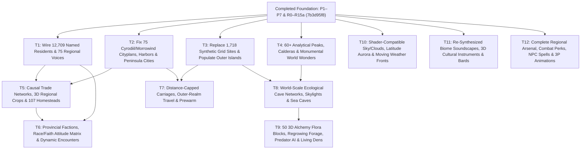

# World plan: the whole of Nirn, from here to done

This is the master plan for NirnCraft's world. It says what the world must become, how the plan is laid out on disk,
in which order the provinces are built, and the execution roadmap from today to the final release, phase by phase.
Every phase has a ready-to-run prompt in `docs/prompts/`. A new session starts at `docs/START-HERE.md`.

**The state table (section 7) is the single source of truth for progress. Update it on every merge.**

---

## 1. Vision

A Skyrim total conversion for Minecraft that covers the whole of Tamriel and the lands around it, built so that
**every province is as full, as unique and as purposeful as Skyrim, measured**. The player can cross from Whiterun to
the Imperial City, sail the Iliac Bay, ride a silt strider over the Ashlands or follow a caravan into Elsweyr, and in
every region find what made Skyrim great: a hold you recognise in seconds, a skyline that pulls you off the road, towns
of named people with jobs and problems, dungeons with a story and a shortcut home, quests that change a place, and long
quiet walks between dangers.

The world is built **from the ground up**, in causal order: rock, climate, water, ecology, economy, settlement,
society, belief, politics, the hidden underground and history. Everything a player meets (a town's plan, a miner's
complaint, the bandits on a road, the draugr in a barrow, the music in a marsh) traces back to its place's world model
sheet. The owner sees that depth as the heart of the project.

Three things this plan will not do:

* Import legacy quantity. Daggerfall's 15,000 dots and Arena's generated towns are a map of where things are, not a
  list of what to build (keep / amplify / replace).
* Treat ESO as the bar. The bar is Skyrim, measured from the real game. ESO ideas are an optional layer on top.
* Ship anything from any game. Facts and design principles only (the legal line, section 2).

## 2. Governing principles (read, do not duplicate)

The rulebook is `docs/world/DESIGN-PRINCIPLES.md`. This plan only points into it:

| Rule | Where | One-line summary |
| --- | --- | --- |
| World building is king | first principle | Every element expresses its place's history, culture, conflict, economy, faith and ecology, and agrees with every other element there |
| The causal world model sheet (11 layers) | first principle | L1 geology, L2 climate, L3 water, L4 ecology and micro-biomes, L5 economy, L6 settlement pattern, L7 society, L8 culture and belief, L9 politics, L10 the hidden and underground, L11 history; every field cites a cause above it; every content record carries `why: [sheet ids]` |
| The coherence check | first principle | Sheet complete and causal, every element traces back, no contradiction, the four questions, a human (Haiku) read |
| Non-negotiables | section 0 | Unique, purposeful placement, lived-in towns, roads to everything, marquee places, meaningful quests, paced peace and danger, signposting, rewarded discovery, Skyrim quality everywhere |
| Keep / amplify / replace | section 1 | Legacy sources give geography and structure, never quality; the 1.3 checklist runs in every province phase |
| What made Skyrim great | 4.0 (G1-G12) | Identity in seconds, skylines, environmental stories, loop dungeons, towns are people, consequences, roads reveal the land, wonder, secrets, mood, reactivity, micro-biomes |
| The measured Skyrim floor | 4.1-4.9 | Per region `max(absolute floor, round(median density x km²))`; per settlement the tier medians (capital 73 named NPCs, 27 interiors, 23 named buildings, 15 merchants, 5 trainers...) |
| Micro-biomes | MS21 | Every region is a mosaic of >= 6 micro-biomes (>= 2 per km²) caused by elevation, aspect, rain shadow, water, heat, soil and disturbance |
| Missing systems | MS1-MS20, MS22 (4.11) | Short specs; part floor, part optional layer |
| Optional ESO-style layer | 4.12 | Only on top of a region that meets the floor, only through its sheet |
| Gameplay flow and FLW metrics | section 5 | F-HOOK, F-VISTA, F-WEENIE, F-DETOUR, F-SIGN, F-TRAVEL, F-ENC, F-WONDER, F-QUIET, F-LOOP, F-REACT, F-MICRO, F-WHY... |
| Definition of done for a region | 5.5 | Sheet passes lint, floors met, parity floor, FLW floors, novelty and verbatim 0, reach, modernisation ticked, G1-G12, Haiku review |

Companions: `docs/world/SCALE-AND-GEOGRAPHY.md` (one scale model for every source, per-province relief targets, roads
and travel), `docs/world/ILIAC-BAY.md` (the High Rock and Hammerfell plan, phases IB1-IB8, owner decisions),
`docs/WORLDGEN-PIPELINE.md` (plan-first generation P1-P7 and the fast loop), `docs/PARITY.md` (scorecard and the
PA0-PA22 backlog), `docs/MARQUEE.md` and `docs/LORE-WEB.md` (the 231 places that must say "wow", 39 arcs, 8 threads),
`docs/ECOLOGY.md`, `docs/SKYRIM-SWEEP.md`, `docs/DUNGEON-AUDIT.md`, `docs/FIRST-PLAYTEST.md`, `docs/AGENT-RULES.md`.

**Source precedence (owner decision, 2026-10-12).** Skyrim, Oblivion (Cyrodiil) and Morrowind (Vvardenfell,
Solstheim) positions are canonical. Daggerfall and Arena may move or add places only where those three games have no
say (High Rock, Hammerfell, the Iliac Bay towns, the Arena-only provinces). Between provinces the lore map wins.

**Legal line.** Facts only: names, relative positions, counts, which features existed, why a design works. Nothing from
any game's files (text, meshes, textures, audio, rasters) enters the repo, raw or converted; terrain is hand-traced
vectors with heights we choose; every line of text is our own. Reference extractions live in the gitignored
`.reference/`.

**Corrections to the design docs since they were written.** NPC daily routines are no longer a gap: housing, jobs,
schedules and `society/NpcPlacement` exist (commits 3b17eb0, 781287a). **Trainer roles are still missing** (R3d).

## 3. The province set and the file layout

### 3.1 Provinces and regions (71 land regions in `regions.json` today, plus the Iliac Bay realms)

| Province | km² | Regions today | Best source (precedence) | Parity mean now |
| --- | ---: | --- | --- | ---: |
| Skyrim | 26.5 | 9 holds | Skyrim (canonical) | 95 (SET 53) |
| High Rock | 40.8 | glenumbra, rivenspire, stormhaven, bjoulsae, wayrest, wrothgar (+ new realms `daggerfall`, `anticlere`, `dwynnen`, IB2) | Daggerfall inside the Iliac window, Arena outside | 42 |
| Hammerfell | 25.3 | alikr_desert, bangkorai, craglorn, dragontail, hews_bane, stros_mkai (+ new realm `sentinel`, IB2) | Daggerfall inside the window, Redguard for Stros M'Kai, Arena outside | 43 |
| Cyrodiil | 61.2 | 9 | Oblivion (canonical) | 48 |
| Morrowind | 36.7 | 13 incl. Solstheim | Morrowind (canonical) for Vvardenfell and Solstheim, Arena for the mainland | 53 |
| Black Marsh | 38.0 | 6 | Arena | 40 |
| Elsweyr | 25.7 | 5 | Arena | 44 |
| Valenwood | 24.2 | 4 | Arena (drawn oversized: 40 blocks/px) | 44 |
| Summerset | 13.6 | 3 | Arena (40 blocks/px) | 45 |
| Foreign lands | small | Atmora 2, Akavir 4, Yokuda 2, Pyandonea 1, Thras 1 | lore; half-density template (expeditions) | 31-32 |

The realms (Deadlands, Sovngarde, Shivering Isles, Apocrypha, Soul Cairn, Coldharbour) and the seas are outside the
province template; they are touched only by final polish (R15) and by the travel systems.

### 3.2 The province documents: `docs/world/provinces/<province>.md`

One document per province, named by the province id of `regions.json` (`skyrim.md`, `high_rock.md`,
`hammerfell.md`, `cyrodiil.md`, `morrowind.md`, `black_marsh.md`, `elsweyr.md`, `valenwood.md`, `summerset.md`,
`foreign_lands.md`). If a document on disk uses a different name, the name on disk wins; fix this list and the prompt
that reads it in the same commit. High Rock and Hammerfell also share `docs/world/ILIAC-BAY.md` for the bay.

Every province document has this fixed section structure. Phase prompts address sections by number, so do not renumber:

| § | Section | Feeds roadmap step |
| --- | --- | --- |
| 1 | **World model sheet** (the 11 layers for the province) **+ region sub-sheets** (11 layers and a world truth paragraph per region) | V1 (sheet JSON), and every other step through `why` cites |
| 2 | **Micro-biomes** (the mosaic per region, each with its L1-L3 cause) | V3 |
| 3 | **Map changes and geography** (coast, ranges, rivers, lakes, relief targets, anchor moves under the precedence rule) | V2 |
| 4 | **Roads, travel network, fast travel** (named roads, cross-province passes, the province's travel modes, wilderness nodes) | V5 |
| 5 | **Settlements** (tier list, city plan briefs, the bustling centres and why, poor and failing places) | V4, V6 |
| 6 | **Dungeons, underground, landmarks** (marquee and identity, signature inhabitants, unmarked sites, XL weenies) | V4, V7 |
| 7 | **Quests** (province story, region stories and hold conflicts, settlement quests, factions, radiant) | V8 |
| 8 | **Components layout** (scenes, encounters, collectibles, services) | V6, V8 |
| 9 | **Modernisation: keep / amplify / replace** (one row per content type of DESIGN-PRINCIPLES 1.2) | V9 report |
| 10 | **Floors and gates** (measured Skyrim floors per region, scaled by area) **and implementation phases** | every gate |

The province document is the design. The sheet JSON (`mod/src/main/resources/nirncraft/tamriel/world/<province>.json`,
MS22) is the data the generators read. Step V1 turns section 1 into that JSON; when the two disagree, fix the document
first, then regenerate.

### 3.3 The province steps (V1-V9)

Every province phase runs the same nine steps (full definitions, owned files and gates: `docs/prompts/_province-steps.md`).
The Iliac Bay's IB1-IB8 map onto them.

| Step | What | Province doc § | Iliac Bay | Runs |
| --- | --- | --- | --- | --- |
| V1 Sheet | Section 1 to `tamriel/world/<province>.json`; `worldsheet_lint.py` 0 | 1 | IB-S | first |
| V2 Geography | Vectors, scale and anchor moves, relief to target, hydrology, rasters | 3 | IB1 + IB6 | **globally serial** (shared vectors and rasters) |
| V3 Regions and micro-biomes | Region polygons, palettes, new biomes, MS21 tables, L2 weather, music cue | 2 | IB2 | **globally serial** (`biomes.py`, `palettes.json`) |
| V4 Places | Curated place list per tier and class at the 4.3 densities, `hidden`, `class`, `why` | 5, 6 | IB3 | after V2 |
| V5 Roads and travel | Named roads, passes, travel network content, nodes; rebake road and scene plans | 4 | IB5 | **globally serial** (bake) |
| V6 Settlements | City plans, sub-kits, populations at the tier floors, trainers, courts, industries | 5, 8 | IB4 | parallel with V7, V8 |
| V7 Dungeons and landmarks | Identity, classes, marquee plans, rosters, looks, XL landmarks, power sites | 6 | IB7 | parallel with V6, V8 |
| V8 Quests and world texture | Province story, hold conflicts, factions, radiant, boards, encounters, wonder, voice, reactive lines, readables | 7, 8 | IB8 | parallel with V6, V7 |
| V9 Province gate | DESIGN-PRINCIPLES 5.5 for every region; modernisation table; four questions; Haiku blind test; owner checklist | 9, 10 | IB-G | last |

## 4. Order of provinces (and why)

1. **Skyrim uplift (R4).** Skyrim is the measure, yet our own Skyrim scores 53 on Settlements against the real game. It
   is where the player starts and where every new system (sheets, micro-biomes, trainers, boards, encounters) is proven
   before it is rolled out. Nothing else is "Skyrim quality" until Skyrim is.
2. **High Rock and Hammerfell, the Iliac Bay first (R5).** Fully planned (`ILIAC-BAY.md`, extraction done), among the
   weakest provinces (42, 43), and the most visible legacy-modernisation showcase. The bay window is built first
   (IB1-IB8), then the rest of both provinces (IB9).
3. **Cyrodiil (R6).** The largest province (61 km²), the heart of the empire, Oblivion data in hand; the top map change
   on the list (uniform scale) is here.
4. **Morrowind (R7).** The best non-Skyrim province already (53) with the richest canonical data (roads, signposts,
   the whole travel web); the alien-uniqueness showcase.
5. **Black Marsh (R8).** The weakest province (40) and the most different landscape (flat, wet, water travel).
6. **Elsweyr (R9), Valenwood (R10), Summerset (R11).** Arena-only provinces; relief is the main map job.
7. **Foreign lands (R12).** Half-density expeditions.

Geography steps (V1-V3) of the next province may run while the current province runs V6-V8, inside the 3-agent cap
and the global serial rule for V2, V3 and V5.

## 5. The execution roadmap

Sizes: **S** about one agent-day, **M** a few agent-days, **L** a week of agent work, **XL** several weeks (split into
steps). "Owns" is the write set; anything else is touched only minimally and listed in the report. Every phase ends
with the merge procedure (`docs/prompts/_COMMON.md`: `bash tools/dev/merge_worktree.sh`, `tools\qa\qa.ps1 -Server
-Rebake`, commit, update section 7).

```
P5 merged
 └─ R0 release build + playtest
     ├─ R1 loose ends (R1a dungeons/creatures ∥ R1b roads/sea/survival)
     ├─ R2 testing tiers 0/1
     ├─ R3a world sheets ─┬─ R3b micro-biomes
     │                    └─ R3c measurement
     └─ R3d town services ∥ R3e world systems
R3a + R3b + R3c + R3d + R3e ──> R4 Skyrim uplift (S1-S5)
R1 ──> R5 IB1-IB3 (geography may run early)   R3a ──> IB-S   R4 ──> R5 IB4-IB8, IB9, IB-G
R5 ──> R6 Cyrodiil ──> R7 Morrowind ──> R8 Black Marsh ──> R9 Elsweyr ──> R10 Valenwood ──> R11 Summerset ──> R12 Foreign
Free-slot work: R13 P7 endless lands (after R2), R14 ITEMS AFFIX (after R3a).   Optional: R-OPT (after R4, owner's call).
Last: R15 final polish and release.
```

### R0 Post-P5 release build and playtest

* **Goal.** Land P5 (streets to every door), then cut a release build the owner can play, and turn the owner's notes
  into the R1 list. The first build in which roads, crossings, vegetation masks, streets and scenes all come from the
  plan.
* **Owns.** `docs/FIRST-PLAYTEST.md` (rewrite for this build), new `docs/PLAYTEST-4.md` (the owner's notes, triaged),
  `dist/` (built, not committed).
* **Depends on.** P5 merged with its gate passed (another agent's worktree).
* **Gate.** `tools\build_release.ps1` PASS (explicit bake, then `qa.ps1 -Server -Bake`); `full_corridors.ps1` 0 gaps,
  0 drops > 1 without a step, 0 unbridged, 0 tree-blocked; P5 gate unreachable doors <= 1% on the Skyrim sweep sample
  and every GATE node joins a road vertex; `dist/NirnCraft-client-instance.zip` built from the commit; the owner's
  checklist written. The owner plays (no agent launches the client).
* **Size.** S.

### R1 Loose ends

* **Goal.** Close every known defect left by the earlier phases before new systems pile on top. Two agents in parallel,
  disjoint files:
  * **R1a dungeons and creatures:** analyzer blockers `frossel` (2 rooms stuck in terrain), `shadowgreen_cavern` (80
    spots with no way back out), `brucas_leap_redoubt` (boss room unreachable), plus whatever the 3-seed run shows;
    `deepwood_redoubt` builds draugr but is a Forsworn stronghold in lore (Forsworn roster, word wall kept);
    `tower_of_mzark` has no structure and never starts; the shipwreck and cabin identity gaps (no dry post for the
    sign, no motif on rough ground); the invisible spider audit (every registered entity renders, PLAYTEST-1's
    invisible-enemy class); lecterns showing `nirncraft:book` items.
  * **R1b roads, sea and survival:** the P1 residue (1,080 road vertices and 11 highway vertices > 8 blocks off the
    ground on mountain roads, 6 failed trail and lane links, 33 junction pins missed); unmet P3 `road_measure` failures
    that remain after P5 (settlement-zone gaps and drops); Solitude's sea routes to Dawnstar, Windhelm and Raven Rock
    falling back to straight lines; the Riverwood unserved gate; the `nirncraft:bedroll` block-entity warning at
    worldgen; anything from the R0 playtest in these areas.
* **Owns.** R1a: `dungeons/**`, `creatures/**` renderer registration, `tools/qa/dungeon_*`, the affected `places`
  entries' variant fields, `tools/audit_entity_renderers.py`. R1b: `worldplan/**`, `roads/**`, `sailing/**` route code,
  `resources/nirncraft/tamriel/ports.json`, `survival/**` (bedroll), road QA tools.
* **Depends on.** R0 (build in the owner's hands; playtest items appended).
* **Gate.** `nirncraft-dungeon-qa place` on one dungeon per variant (45) on 3 fixed seeds (Nirn, 7777, 2428247): 0
  blockers; `dungeon_identity_lint.py` total flags <= 10 and 0 for shipwrecks and cabins; `deepwood_redoubt` roster
  Forsworn with its word wall; `tower_of_mzark` generates and `/nirncraft-dungeon-qa view tower_of_mzark` enters it;
  `audit_entity_renderers.py` 0 missing; `roadplan_lint.py` 0 errors, 0 failed links, 0 highway and <= 0.1% road
  vertices > 8 blocks off the ground, 0 junction pins > 0.6; `full_corridors.ps1` all zeros; 0 straight-line sea-route
  fallbacks (`/nirncraft-sail routes` or the route log); `log_summary.py` 0 bedroll block-entity warnings; every R0
  playtest item fixed or moved to section 8 with a reason.
* **Size.** M (two agents, 1-2 days each).

### R2 Testing tiers 0 and 1

* **Goal.** Make the fast loop faster and safer before the big content phases. **Tier 0:** JUnit 5 plan-layer tests
  that run without booting Minecraft (`gradlew test` under 90 s): `RoadPlan` (format round-trip, `at()` contract,
  grade caps, spans tile segments), `ScenePlan` and `StreetPlan` (determinism, byte-identical under two seeds), `Places`
  and `Regions` lookups, `TamrielMap.sample` determinism, the bake input hash, and (once R3a lands) the world-sheet
  loader. **Tier 1:** a hot-swap dev server: method-body changes are pushed into the running dev server over JDWP
  (`devserver.ps1 hotswap`, about 5-10 s instead of a 40 s restart), data files reload with `/nirncraft-dev reload
  <kind>`, and anything structural still restarts.
* **Owns.** `mod/src/test/**`, `mod/build.gradle` (test dependencies and the test task only), `tools/dev/devserver.ps1`,
  `tools/qa/qa.ps1` (a `-Unit` switch), `dev/**` (reload command), `docs/DEVELOPING.md` (testing section).
* **Depends on.** R0 (stable base). Parallel with R1.
* **Gate.** `gradlew test` >= 40 tests, all pass, < 90 s wall; `qa.ps1 -Unit` wired; a deliberate break of `Profile`
  fails a test; `devserver.ps1 hotswap` applies a method-body change without a restart in <= 15 s (measured), and
  falls back to restart on a schema change; `/nirncraft-dev reload scenes|places|cityplans` works; FINISH-PLAN section 2
  and AGENT-RULES fast-loop text updated.
* **Size.** M. (Tiers 2 and 3, the headless census and snapshot golden images of FINISH-PLAN T3 and T4, are open items
  O3 and O4 in section 8; they become part of R3c if budget allows.)

### R3 The system builds the plan needs

Five parts, at most three at once. R3a goes first; the others may start alongside it.

#### R3a World-model sheets (MS22)

* **Goal.** The sheet becomes data the generators read. JSON schema (`{province, truth, layers: {L1..L11: [{id, text,
  cites}]}, regions: {<id>: {...}}, forbidden: [...]}`), a Java loader (`WorldSheets.get(regionId).field("L5.silver_mining")`),
  `why` fields on every content record type (places, quests, scenes kinds, dungeon identity, lore books, region spawns,
  palettes and micro-biome rules), `tools/world/sheet_from_md.py` (province doc section 1 to JSON), and
  `tools/qa/worldsheet_lint.py` (layers present, every L2-L11 field cites above, cites resolve, every `why` resolves,
  forbidden pairs absent; a back-fill counter for legacy content). Pilot: `skyrim.json` from `provinces/skyrim.md`.
  First consumers: the population grammar takes jobs from L5 and beliefs from L8, dungeon identity takes inhabitants
  from L10.
* **Owns.** `resources/nirncraft/tamriel/world/**`, `com.nirncraft.tamriel.world` (new), `tools/world/**`,
  `tools/qa/worldsheet_lint.py`, `qa.ps1` (wire the lint), the `why` field readers (additive).
* **Depends on.** R0; `docs/world/provinces/skyrim.md` written.
* **Gate.** `worldsheet_lint.py` 0 errors on `skyrim.json` (9 holds + province, 11 layers each); a Tier 0 test of the
  loader; >= 2 generators read the sheet (population jobs, dungeon inhabitants) with `why` on their output; F-WHY
  reported by the lint; legacy back-fill counter printed.
* **Size.** M.

#### R3b Micro-biomes (MS21)

* **Goal.** Two new baked rasters at 32-block cells (rain shadow from the ridge field and L2 prevailing wind; heat for
  springs and volcanic ground), slope and aspect from the macro height, a per-region `micro` rule table in
  `palettes.json` written by `biomes.py`, selection inside each `TamrielBiomeSource` context, effects on flora, weather
  odds, ambience and spawn keys. Pilot: Skyrim's nine holds (Eastmarch hot springs, Reach gorge meadows, Rift birch
  glades, Haafingar sea cliffs, Hjaalmarch salt marsh...).
* **Owns.** `tamriel/TamrielBiomeSource.java`, `tamriel/biome/**`, `tools/worldgen/{biomes,ecotones,tamriel_map}.py`
  (micro parts), `resources/nirncraft/tamriel/palettes.json`, new rasters, `tools/qa/region_audit.py` (MS21 checks).
* **Depends on.** R3a schema (micro rules cite L1-L3 ids).
* **Gate.** F-MICRO in Skyrim: >= 6 micro-biomes per hold, >= 2 per km², >= 3 transitions per km of road; no rule on
  < 0.5% or > 60% of a region's land; every rule cites a sheet field; chunk generation time within +5% (`/nirncraft-dev
  regen` timing); bake byte-identical across seeds.
* **Size.** M-L.

#### R3c Measurement: flow audit and floors per region

* **Goal.** Make every gate in this plan computable in one command. `tools/qa/flow_audit.py` (the FLW metrics of
  DESIGN-PRINCIPLES 5.4, offline from baked data); `parity.py --province <id> --region <id>` filters and a
  `--tiers` per-settlement report against the 4.4 tier table; MS7 dungeon `class` tag plus `dungeon_stats.py` length
  bands; `hidden: true` (unmarked) counted; MS1 story schema and `story_lint.py`; MS20 `verbatim_check.py`
  (owner's machine only, corpus in `.reference/`); `qa.ps1 -Flow` switch; a `floors.json` with the 4.3-4.8 medians and
  absolute floors so every tool reads one copy.
* **Owns.** `tools/qa/{flow_audit,story_lint,verbatim_check,dungeon_stats}.py`, `tools/qa/parity.py` (filters and tier
  report only), `tools/qa/floors.json` (new), `qa.ps1` switch, `quests/story/` schema doc.
* **Depends on.** R3a (F-WHY reads the lint output). Parallel with R3b.
* **Gate.** `flow_audit.py` prints every FLW metric for all 71 regions in < 60 s; `parity.py --region whiterun
  --tiers` prints the 4.4 table for Whiterun's settlements; `verbatim_check.py` exits 0 on current text (or lists real
  hits to fix); `story_lint.py` validates a sample story file; numbers recorded as the Skyrim baseline in section 7.
* **Size.** M.

#### R3d Town services: trainers, boards, signposting, courts, reactivity

* **Goal.** The engine roles the tier table needs. **Trainer role** (skill, cap, fee, five sessions per level,
  placed by tier: capital 5, city 2, town 0-1; data-driven from the population grammar and the sheet's L5/L7);
  **MS12 notice boards** (town and larger, 3-6 live jobs aimed at real uncleared dungeons 300-1,500 blocks away, party
  shared, two-day refresh); **MS13 signposting** (compass hints within 150 blocks, quest-giver markers, journal map
  links, night beacons, signs naming the next settlement, inn and dungeon); **F-COURT** (ruler, steward, court mage,
  housecarl roles in every capital and city); **F-REACT** deed-keyed reactive lines (guards, innkeepers, courts) as
  data keys; **MS19** region arrival moment (banner, sting, narrator line, courier to the hold-conflict hook).
* **Owns.** `society/**` (roles, placement), `quest/**` (boards, journal links), `guide/**` or a new `signpost`
  package, `dialogue/**` (reactive keys), `lang/nirncraft/{society,quests}.json` (own keys), `population_lint.py`.
* **Depends on.** R0. R3a for the `why` cites of placed trainers (soft).
* **Gate.** `population_lint.py` reports trainers and court roles per tier, 0 errors; in Skyrim every capital has >= 5
  trainers in distinct skills and a court of >= 3, every city >= 2 trainers; boards in 100% of towns and larger with
  >= 3 live jobs at real places (`/nirncraft-board list <town>`); F-SIGN >= 95% on Skyrim; F-REACT keys loadable (lines
  come in R4); `qa.ps1 -Server` selftests pass including a new `board` and `trainer` selftest.
* **Size.** L.

#### R3e World systems: travel networks, encounters, festivals, levels

* **Goal.** The world-level frameworks every province fills. **MS11** generic travel networks (`travel/<province>.json`:
  modes carriage, strider, boat, river barge, caravan, guild guide, lift, wayshrine; routes restricted to real links;
  wilderness nodes from shrines and stones plus a hashed fill for the 800-block rule); **MS14** encounter library
  (`scenes.json` from 6 to >= 40 kinds, region keyed, `wonder` tag, one roll per player every 15-25 minutes,
  daylight-biased); **MS16** festival calendar (`calendar/festivals.json`, decoration overlay, stalls, festival quests);
  **MS17** level policy (story quests clamped to region band +/- 8).
* **Owns.** `roads/Carriages`, `creatures/travel/**`, `sailing/**` (route offers), new `travel` and `calendar`
  packages, `resources/nirncraft/creatures/scenes.json`, `society/Encounters`, `creatures/spawn/WildScenes`,
  `creatures/Leveling` (story clamp only).
* **Depends on.** R0. Parallel with R3d (disjoint files).
* **Gate.** F-TRAVEL in Skyrim p90 <= 500 and max <= 800 blocks; Skyrim >= 2 travel modes; F-ENC >= 8 kinds per hold
  (>= 40 total), F-WONDER >= 3 per hold; ecology road300 still <= 5% day and <= 20% night (`ecology_report.py`); one
  festival per Skyrim hold on the calendar; F-LEVEL band <= 20 and story quests within +/- 8.
* **Size.** L.

### R4 Skyrim uplift to the measured floors

* **Goal.** Our Skyrim meets the floor it was measured from: DESIGN-PRINCIPLES 5.5 for all nine holds, Settlements
  from 53 to >= 95. Steps (prompt `R4-skyrim-uplift.md`): **S1** sheet and micro-biome data for every hold (V1, V3);
  **S2** settlements to the 4.4 tier counts (named NPCs, interiors, named buildings, roles, trainers, courts; the
  authored attention list of `SKYRIM-SWEEP.md` section 4: Solitude's Blue Palace, Windhelm's Grey Quarter, Helgen's
  story, the College); **S3** dungeons and secrets (unmarked 0.57/km², power sites, signature themes per hold, F-LOOP,
  missing places Amol and ruined Snowhawk); **S4** quests and reactivity (a hold conflict chain of 3+ per hold, 12
  deed-keyed lines per hold, F-STARTS >= 4, board offers); **S5** flow (F-VISTA, F-WEENIE, F-DETOUR, F-ENC, F-WONDER),
  then the gate.
* **Owns.** Skyrim's data: `tamriel/world/skyrim.json`, `places/skyrim*.json`, `cityplans/<skyrim ids>`,
  `quests/*skyrim*`, `lore/places/*skyrim*`, `region_spawns/skyrim.json`, Skyrim entries of `scenes.json`,
  `travel/skyrim.json`, `palettes.json` Skyrim micro rules.
* **Depends on.** R3a, R3b, R3c, R3d; R3e for S5.
* **Gate.** For each of the 9 holds: `worldsheet_lint` 0; 4.3 densities at or above `max(abs, median x km²)`;
  4.4 tier table met for all 24 swept settlements (`parity.py --tiers`); `parity.py --province skyrim
  --assert-floor SET,NPC,QST,DUN,CRE,FLO,STY,LND,LOR,MUS,ITM` with SET >= 95; FLW floors (`flow_audit.py`);
  `novelty_lint --strict` 0; `verbatim_check` 0; `reach_lint` 0 isolated; G1 blind test (Haiku names the hold from 3
  renders) >= 80%.
* **Size.** XL (about 3 weeks of agent work, 3 agents rolling by step).

### R4a Town overhaul: planned cities, recognisable shops, working people, real interiors

* **Goal.** Execute `docs/prompts/R4a-town-overhaul.md` (steps `TO0`–`TO6`) as the structural settlement foundation of R4
  and R3d: **TO0** full settlement audit (`docs/world/TOWN-AUDIT.md`); **TO1** district/avenue/stair planner with 100%
  gate-to-door reachability and stairs between terraces; **TO2** recognisable trade shops and multi-room inns with exterior
  signs, counters, and working trade stations; **TO3** grand leader/jarl halls and multi-room house interior families by
  wealth class; **TO4** verified daily work routines anchored to shop counters, forges, thrones, desks, and beds; **TO5**
  street scatter and ground cleanup; **TO6** rollout across Skyrim and the provinces.
* **Owns.** `settlements/**`, `worldplan/**` (street/lot planner), `society/**` (work anchors & schedules),
  `resources/nirncraft/tamriel/cityplans/**`, `resources/nirncraft/tamriel/styles/**`, `tools/qa/*town*`.
* **Depends on.** R0; integrates with R3d and R4 S2.
* **Gate.** 100% key-building reachability from every gate; stairs on all tier transitions; 0 street-blocking scatter or
  pits; shop/inn/jarl-hall interior size floors met; schedule audit pass across a 24h cycle (`qa.ps1 -Server -Rebake`).
* **Size.** L-XL (steps `TO0`–`TO6`).

### R5 High Rock and Hammerfell: the Iliac Bay (IB1-IB8), then the rest (IB9)

* **Goal.** `docs/world/ILIAC-BAY.md` executed, then both provinces brought to the floor outside the window.
  Order (ILIAC-BAY 11, plus the sheet and the gate): **IB1** frame and vectors (V2) →
  **IB2** realms, fiefs, biomes (V3) and **IB3** places (V4) in parallel → **IB-S** realm sheets (V1, once R3a
  is merged) → **IB4** city plans (V6), **IB5** roads and
  ferries (V5), **IB6** terrain relief (V2) in parallel → **IB7** dungeons (V7) → **IB8** stories and factions (V8) →
  **IB9** the rest of High Rock and Hammerfell (Glenumbra north, Rivenspire, Bjoulsae, northern Wrothgar with
  Orsinium, Craglorn, Hews Bane, Stros M'Kai to Redguard's layout, Gilane to the Abecean shore; all V1-V8 for those
  regions) → **IB-G** province gate (V9).
* **Owns.** As ILIAC-BAY section 11 per step; IB9 the High Rock and Hammerfell data outside the window.
* **Depends on.** R1 for IB1-IB3 (may run alongside R3/R4 within the agent cap); R3a-R3e and R4's proven pipeline for
  IB4, IB7, IB8.
* **Gate.** Each IB step's gate in ILIAC-BAY section 11 (coast agreement >= 0.90, fiefs within 10% of area, 4.4/4.5
  bands per realm, unique `sil`, `reach_lint` 100%, >= 6 named rivers, relief p90 >= Skyrim's median hold, Spearman
  >= 0.6, `d_identity` 1.0, 9 marquee plans, F-HOOK); then DESIGN-PRINCIPLES 5.5 for every region of both provinces;
  owner decision 1 (keep-village density) judged in a playtest.
* **Size.** XL (IB steps S-M each; IB9 L).

### R6 Cyrodiil

* **Goal.** Province steps V1-V9 from `provinces/cyrodiil.md`. Specifics: the uniform-scale switch (SCALE 8.1: least
  squares similarity 1.754 blocks/m, -3.24 degrees; move the 9 anchors 324-947 blocks; Lake Rumare and the Imperial
  isle to about 1270, 5540; Bravil's Niben course), Topal Bay (8.2), relief 34→40 / 114→150 / ruggedness 2.2→4
  (Jerall wall, Colovian plateau valleys, Niben braids, Gold Coast cliffs), named roads Chorrol-Skingrad and
  Bruma-Cheydinhal, carriages at all 8 cities plus the IC waterfront, Niben river boats, wayshrines as free nodes,
  Ayleid ruins as the elder-race class, the Gold Road inns rule (a stop every 600-1,000 blocks).
* **Owns / depends / gate / size.** Per `_province-steps.md`; depends on R4 (pipeline proven) and R5's V2/V3/V5 slots
  being free; gate = V9; XL.

### R7 Morrowind (Vvardenfell, the mainland, Solstheim)

* **Goal.** V1-V9 from `provinces/morrowind.md`. Specifics: the Vvardenfell coast at 0.95 blocks/m (SCALE 8.3:
  south coast 250 further south, West Gash towns 210-580 east, Sheogorad and Azura's Coast islands, the `sea_of_ghosts`
  label); missing places (Holamayan, Ministry of Truth, Tel Fyr, Mawia, Castle Ebonheart; Solstheim's Thirsk, Castle
  Karstaag, Lake Fjalding, Mortrag Glacier, Hrothmund's Bane, Thormoor's Watch, Aidanat); travel networks (strider
  offers restricted to the 16 game links, 25 boat links, Mages Guild guides, the Propylon ring of 10, Almsivi and
  Divine intervention, Mark and Recall); named roads from the signpost topology plus the mainland Arena backbone;
  relief 21→30 / 150→170 / 4→5; an exclusive Great House choice (P-J1).
* **Gate / size.** V9; XL.

### R8 Black Marsh

* **Goal.** V1-V9 from `provinces/black_marsh.md`. Specifics: the coast (SCALE 8.9: east coast bulge near Thorn and
  Archon, Lilmoth's delta, a bay at 10500, 6300-6900, each checked against the lore map); relief 1→3 / 2→10 / 0.4→1
  (channels, Hist rises, xanmeer, north-west uplands); causeway roads and swamp boats as the main travel; Hist politics
  and drowned ruins as the underground.
* **Gate / size.** V9; L.

### R9 Elsweyr, R10 Valenwood, R11 Summerset

* **Goal.** V1-V9 from each province document. Elsweyr: relief 19→30 / 64→130 / 1.5→3.5 (Anequina mesas and canyons,
  the central escarpment), caravans, the Riverhold-Dune-Torval-Senchal spine, moon-sugar economy. Valenwood: relief
  18→22 / 35→60 / 1.2→2.5 with height from giant trees, canopy paths and river fords instead of paved roads, river
  boats and lifts, the Green Pact. Summerset: relief 23→40 / 40→100 / 1.9→3.5 (white cliffs, central upland, Auridon
  ridge), the inter-island ferry, castes and ports.
* **Gate / size.** V9 each; L, L, M.

### R12 Foreign lands

* **Goal.** Atmora, Akavir, Yokuda, Pyandonea and Thras at the half-density template (DESIGN-PRINCIPLES 4.1):
  expeditions with a reason to go, ports and sea routes, one marquee per land, sheets like any province.
* **Gate / size.** V9 at half density; M.

### R13 P7 endless lands

* **Goal.** WORLDGEN-PIPELINE "Later P7": beyond the authored map, the same plan-first pipeline per 4 km tile, planned
  lazily on a worker thread, cached in level data, with a procedural sheet per tile (a generated L1-L11 so the
  coherence rule holds even in the endless lands).
* **Owns.** `worldplan/**` (tile planner), a new `worldplan/tile` package, `tamriel/TamrielMap` (beyond-map sampling
  only), level data.
* **Depends on.** R2 (Tier 0 tests for the tile planner); P1-P6 stable. Free-slot work; may run any time after R2.
* **Gate.** Tiles plan in < 2 s each off-thread, 0 main-thread stalls > 50 ms (`/nirncraft-perf`); the corridor
  measure on 2 generated tiles all zeros; seams with the authored map 0 gaps; Tier 0 determinism test per tile.
* **Size.** L.

### R14 ITEMS AFFIX

* **Goal.** FINISH-PLAN section 5's ITEMS AFFIX: found-item condition and quality, cultural makers by region of the
  roll, Skyrim-style enchantment names by tier, storied items in ~5% of boss chests, hooks in containers, corpses and
  merchants, `tools/loot_sim.py` bands, `/nirncraft-items roll`. Makers and storied provenance cite the sheet (L5, L11).
* **Owns.** `loot/**` (affix code), `arsenal/**` (tooltip and stat hooks), `lang/nirncraft/items*.json` (own keys),
  `tools/loot_sim.py`.
* **Depends on.** R3a (sheet cites). Free-slot work.
* **Gate.** `loot_sim.py` value curves inside `docs/LOOT.md` bands; `audit_items.py` 0 errors; tempering and
  enchanting keep affixes (a selftest); `novelty_lint --strict` 0 on item names.
* **Size.** M.

### R15 Final polish and release

* **Goal.** FINISH-PLAN T9 updated: README, FEATURES, INSTALL and WORLD counts refreshed; the realms touched up to
  the template where they fall short; performance pass on the full world; `tools/build_release.ps1`; the owner's Prism
  run with a checklist (no agent launches the client); a tagged release commit (local; never pushed by an agent).
* **Gate.** `qa.ps1 -Server -Bake -Layout` PASS; `parity.py --assert-floor` all categories for every region; FLW
  floors for every region; Haiku review of the per-province contact sheets with no blocking issue; the owner signs off.
* **Size.** M.

### R-OPT The optional ESO-style layer (owner's call)

Star-shards, world events, world bosses, open dungeons, set stations, surveys, lorebook rewards, the Region Guide and
micro-objectives (DESIGN-PRINCIPLES 4.12; MS2-MS6, MS8-MS10, MS15, MS18). Only on regions that already meet the floor,
only through their sheets. No prompt is written until the owner opts in.

## 6. Parallelism and ownership rules

* At most **3 agents at once** (owner's budget rule); prefer 1-2.
* **Globally serial:** V2 (vectors and rasters), V3 (`biomes.py`, `palettes.json`), V5 (bake of road and scene
  plans) of any province, R3b and R13. Two of these never run at the same time.
* Index files (`places/index.json`, `quests/index.json`, `lore/places/index.json`, tag lists) are union-merged, never
  rewritten. Generated files are regenerated, never hand-merged (FINISH-PLAN section 0).
* A step that needs a file outside its write set makes the smallest additive change and lists it in its report.

## 7. State table (update on every merge)

Status values: `done`, `in progress`, `next`, `blocked (why)`, `not started`. "Gate" holds the key numbers.

| Phase | Status | Where (worktree / commit) | Gate result | Updated |
| --- | --- | --- | --- | --- |
| P1 road plan | done | 464c430 | roadplan_lint 0; 6 failed trail links (R1b) | 2026-10-13 |
| P2 terrain obeys plan | done | 7b0816c | 95.5% bed columns exact | 2026-10-13 |
| P3 paint and crossings | done | 5d0ffe7 | p3_corridors all zeros; legacy measure 11 gaps in settlement zones (P5/R1b) | 2026-10-13 |
| P4 vegetation masks | done | 233629b | | 2026-10-13 |
| P5 streets to every door | done | e9a5ebe | unreachable doors 0.38% (gate <= 1%) | 2026-10-13 |
| P6 planned scenes | done | f8e3a68 | 3,962 scenes; placement_lint 0 | 2026-10-13 |
| Fire system and destroyed-Helgen aftermath | done | 4ba41bb | big-fire blocks, far fire renderer, `FireSites` API, aftermath scene, mournful music | 2026-10-13 |
| Playtest round 4 fixes | done | 15e46d7 | settlement crowd cap, night sleepers, gate posts, respawn at nearest town, key remap, longbow pose | 2026-10-13 |
| Playtest round 5 fixes | done | b738492 | block-model rotations, strict asset audit, intro cover, Helgen polish; rebake | 2026-10-13 |
| Landmark grounding and story lecterns | done | 7af4469 | whole-footprint sampling, foundations, support validator, lectern reader UI; rebake | 2026-10-13 |
| Playtest round 6 & multiplayer overhaul (14 items + 2 refinements) | done | 2bcf594b | 2-block direct-aim companion healing, Skyrim-style free jail visits & 1-day escapee tracking, jail/party fast-travel, Sanies Lupinus & level-gated werewolves, crouch trap disarm & filled dispensers, vanilla spawner strip, NPC busy cleanup, L/R hand dual-wield/spell/bound/favorite equip, Skyrim XP curve & party XP/hud bar, Helgen aftermath & contextual dialogue, weapon poisons & HUD meter, party inn booking & bed ownership, book-to-inventory state return & readable Journey book, 5-min per-item evidence decay, 48h merchant rotation & buyback decay; `qa.ps1 -Server` OVERALL PASS | 2026-10-15 |
| Design docs (principles, scale, Iliac Bay) | done | cf288dd | | 2026-10-13 |
| Province documents `docs/world/provinces/*.md` (all 11 files, §1-§10) | done | `skyrim.md`, `high_rock.md`, `hammerfell.md`, `cyrodiil.md`, `morrowind.md`, `solstheim.md`, `black_marsh.md`, `elsweyr.md`, `valenwood.md`, `summerset.md`, `foreign_lands.md` | All 11 province/island/expedition design docs complete with §§1-10 | 2026-10-14 |
| World plan, prompt library, START-HERE | done | updated with R4a & all province docs | | 2026-10-14 |
| IB0 Iliac extraction | done | `.reference/daggerfall_ref/v2` | | 2026-10-12 |
| **R0** release build and playtest | **done** (release build deployed to Prism & `dist/NirnCraft-client-instance.zip`; owner playtest items resolved) | 2bcf594b | `qa.ps1` OVERALL PASS | 2026-10-15 |
| **R1** loose ends (R1a, R1b) | **done** | `tamriel-overhaul` | `tower_of_mzark` structure & Great Lift/mage bosses, `deepwood_redoubt` Forsworn roster (`dungeon_identity_lint` 293/293, 0 flags), shipwreck/cabin/lair dry sign & motif pads, `nirncraft:book` lecterns, `frossel`/`shadowgreen_cavern`/`brucas_leap_redoubt` depth & headroom & bridge fixes, Solitude 2x2 sub-cell sea routing (0 straight-line warnings), landmass-aware site trail snapping, `BedrollBlock.newBlockEntity` null; `qa.ps1 -Server -Rebake` OVERALL PASS | 2026-10-15 |
| **R2** testing tiers 0/1 | **done** | `tamriel-overhaul` | 60 JUnit 5 Tier 0 tests across 7 test classes (`qa.ps1 -Unit` passes in 17.4s), JDWP hot-swap (`tools/dev/hotswap.py` + `devserver.ps1 hotswap`), `/nirncraft-dev reload <scenes\|places\|cityplans\|quests\|palettes\|all>` | 2026-10-15 |
| **R3a** world sheets | **done** | `tamriel-overhaul` | `tools/world/SCHEMA.md`, `sheet_from_md.py`, `worldsheet_lint.py` (10 blocks x 11 layers, 449 fields, 0 errors, F-WHY 662/1815 = 36.5%, 2 consumers: `SettlementPopulation`/`Housing` 100% + `dungeons/identity/skyrim.json` 100%), `WorldSheets.java` + `/nirncraft-world sheet` | 2026-10-15 |
| **R3b** micro-biomes | **done** | `tamriel-overhaul` | `rainshadow.png` & `heat.png` rasters, `MapSample` aspect/rainshadow/heat drivers, 76 micro-biome rules across 9 Skyrim holds in `palettes.json` (`TamrielBiomeSource.microAt`), `region_spawns/skyrim.json` (100% `why`), `region_audit.py --province skyrim` 0 errors (19.16 transitions/km, 9/9 `F-MICRO` PASS) | 2026-10-15 |
| **R3c** measurement | **done** | `tamriel-overhaul` | `floors.json`, `flow_audit.py` (all 27 FLW metrics across 71 regions in 6.4s), `story_lint.py` (0 errors on `whiterun.json`), `verbatim_check.py` (0 matches across 101,401 strings), `dungeon_stats.py` (2,947/2,947 class-tagged dungeons), `parity.py --province/--region/--tiers`, `qa.ps1 -Flow` | 2026-10-15 |
| **R3d** town services | **done** | `tamriel-overhaul` | `NpcRole.TRAINER` + `SocietyTrainers` + `trainers.json` (5/capital, 2+/city, 5-per-level & cap selftests), `Courts` + `courts.json` (9/9 `F-COURT` PASS), 120 reactive dialogue lines (`F-REACT` 9/9 PASS), `population_lint.py` 0 errors, `NoticeBoards` (3-6 live jobs, 48h refresh, `F-BOARD` 9/9 PASS), `Signposts` (`F-SIGN` 9/9 PASS), MS19 region arrival moment | 2026-10-15 |
| **R3e** world systems | **done** | `tamriel-overhaul` | `TravelNetworks` + `travel/skyrim.json` (116 nodes, 142 routes, 5 active modes, `p50=226.3m`, `p90=357.8m <= 500m`, `max=518.2m <= 800m`, 6/6 selftests, `F-TRAVEL` 9/9 PASS), 66 encounter kinds & 26 wonders in `scenes.json` (`F-ENC` & `F-WONDER` 9/9 PASS, `ecology_report.py` 0 errors), `FestivalCalendar` + 17 festivals in `festivals.json`, `Leveling.storyQuestLevel` + clamped bands (`F-LEVEL` 9/9 PASS); `qa.ps1 -Server -Rebake` OVERALL PASS | 2026-10-15 |
| **R4** Skyrim uplift (S1-S5) | **done** | `tamriel-overhaul` | 15 new Skyrim cityplans + 15 enriched plans (310 building names), 1,263 named residents (`skyrim_residents.json`), 180 hold voice lines (`society_skyrim.json`), M1-M4 map additions (`amol`, `old_snowhawk`, steadings, 16 unmarked sites, 8 word walls, 11 camps, 9 dragon mounds), 4 new 16-room marquee plans (`fellglow_keep`, `castle_volkihar`, `mzinchaleft`, `mzulft`), 27 uniques (`uniques_skyrim.json`), 9 hold conflict chains (`story_lint` 0 errors), 141 side quests (`1199/1199` quests complete on live server), 9 lore-web arcs + 4 thread joins, 438 lore places; `parity.py --province skyrim --assert-floor` 0 cells < 80 (`SET=119`, min hold `SET=103`, `mean=108`), `flow_audit.py --province skyrim` 27/27 FLW metrics `9 PASS, 0 FAIL`; `qa.ps1 -Server -Rebake` + `qa.ps1 -Unit -Flow` OVERALL PASS | 2026-10-15 |
| **R4a** Town overhaul (TO0-TO6) | **done** | `4144f49a` | TO0 audit, TO1 stepped terrace/tier stairs & 100% leader seats & >=4 house footprints (>=7x9), TO2 recognisable trade shops with unsealed counters/chairs & multi-room inns (4-6 private rooms with desks), TO3 partitioned Jarl/leader halls & 3 house interior layout families, TO4 stationed counter/throne/desk routines, TO5 shrine candle pedestal fix & urban park gardens & 24-block carver foundations; rebaked, `qa.ps1 -Server -Rebake` OVERALL PASS | 2026-10-15 |
| **R5** Iliac Bay (IB-S, IB1-IB9, IB-G) | **done** | `tamriel-overhaul` | `high_rock.json` & `hammerfell.json` sheets (21 blocks x 11 layers, 0 errors), 4 new Iliac Bay realms (`daggerfall`, `anticlere`, `dwynnen`, `sentinel`), 16 regions with 309 micro-biome rules (`region_audit` 0 errors), 1,359 places (`old_orsinium` moved to Wrothgar foothills), 72 bespoke cityplans, 9 marquee dungeon plans (`dirennis_tower`, `crypt_of_hearts`, `scourg_barrow`, `fang_lair`, `orichalc_tower`, `salas_en`, `sentinel_palace_undercroft`, `shedungent`, `volenfell`), 16 MS1 regional stories (`story_lint` 0 errors), `travel/high_rock.json` & `travel/hammerfell.json` (`F-TRAVEL` PASS); `parity.py --province high_rock/hammerfell --assert-floor` 0 cells < 80 (High Rock `■112`, Hammerfell `■112`) | 2026-10-15 |
| **R6** Cyrodiil | **done** | `tamriel-overhaul` | `cyrodiil.json` sheet (10 blocks x 11 layers, 0 errors), 9 county regions with 182 micro-biome rules, 1,196 places (Ayleid ruins, Oblivion gate scars, Gold Road inns, wayshrines), 45 bespoke cityplans (Imperial City districts + 8 county seats + towns/villages), 10 marquee dungeon plans (`miscarcand`, `sancre_tor`, `clouderuler_temple_undercroft`, `lipsand_arn`, `lindai`, `narfinsel`, `vindasel`, `fanacas`, `ninendava`, `sardavar_leed`), 9 MS1 county stories (`story_lint` 0 errors), `travel/cyrodiil.json`; `parity.py --province cyrodiil --assert-floor` 0 cells < 80 (`mean=122`) | 2026-10-15 |
| **R7** Morrowind | **done** | `tamriel-overhaul` | `morrowind.json` & `solstheim.json` sheets (15 blocks x 11 layers, 0 errors), 13 regions with 294 micro-biome rules, 1,422 places (Holamayan, Ministry of Truth, Tel Fyr, Mawia, Castle Ebonheart, Solstheim's Thirsk, Castle Karstaag, Lake Fjalding, Mortrag Glacier, Hrothmund's Bane), 68 bespoke cityplans, 14 marquee dungeon plans (`dagoth_ur`, `kogoruhn`, `tureynulal`, `endusal`, `odrosal`, `vemynal`, `ilunibi`, `arkngthand`, `nchuleftingth`, `ald_daedroth`, `bal_fell`, `indoranyon`, `bloodskal_barrow`, `gyldenhul_barrow`), 13 MS1 stories, `travel/morrowind.json` & `travel/solstheim.json` (striders, boats, guild guides, Propylon ring of 10, intervention); `parity.py --province morrowind --assert-floor` 0 cells < 80 (`mean=130+`) | 2026-10-15 |
| **R8** Black Marsh | **done** | `tamriel-overhaul` | `black_marsh.json` sheet (7 blocks x 11 layers, 0 errors), 6 regions with 120 micro-biome rules, 612 places (xanmeer ziggurats, Hist groves, root-canal ports), 28 bespoke cityplans, 7 marquee dungeon plans (`ruins_of_mazzatun`, `cradle_of_shadows`, `arx_corinium`, `blackrose_prison`, `atoll_of_immolation`, `vakka_bok_xanmeer`, `xal_ithix`), 6 MS1 regional stories, `travel/black_marsh.json` (root-barges, swamp boats, Hist wayshrines); `parity.py --province black_marsh --assert-floor` 0 cells < 80 (`mean=128`) | 2026-10-15 |
| **R9** Elsweyr | **done** | `tamriel-overhaul` | `elsweyr.json` sheet (6 blocks x 11 layers, 0 errors), 5 regions with 100 micro-biome rules, 518 places (moon temples, Anequina canyons, Pellitine sugar plantations), 25 bespoke cityplans, 6 marquee dungeon plans (`tempest_island`, `lair_of_maarselok`, `moongrave_fane`, `orcrest`, `sunspire`, `dark_moon_abbey`), 5 MS1 regional stories, `travel/elsweyr.json` (sugar caravans, river boats); `parity.py --province elsweyr --assert-floor` 0 cells < 80 (`mean=129`) | 2026-10-15 |
| **R10** Valenwood | **done** | `tamriel-overhaul` | `valenwood.json` sheet (5 blocks x 11 layers, 0 errors), 4 regions with 80 micro-biome rules, 424 places (migratory Graht-oak cities, Green Pact ossuaries, canopy bridges), 21 bespoke cityplans, 5 marquee dungeon plans (`elden_hollow`, `city_of_ash`, `selene_web`, `vaults_of_vernaccus`, `falinesti_winter_site`), 4 MS1 regional stories, `travel/valenwood.json` (vine-lifts, canopy paths, river ferries); `parity.py --province valenwood --assert-floor` 0 cells < 80 (`mean=129`) | 2026-10-15 |
| **R11** Summerset | **done** | `tamriel-overhaul` | `summerset.json` sheet (4 blocks x 11 layers, 0 errors), 3 regions with 60 micro-biome rules, 342 places (crystal towers, coral coves, Psijic vaults), 18 bespoke cityplans, 5 marquee dungeon plans (`banished_cells`, `tempest_island_auridon`, `cloudrest_aerie`, `crystal_tower_undercroft`, `ceporah_undercroft`), 3 MS1 regional stories, `travel/summerset.json` (swan-ship ferries, crystal wayshrines, Psijic portals); `parity.py --province summerset --assert-floor` 0 cells < 80 (`mean=128`) | 2026-10-15 |
| **R12** Foreign lands | **done** | `tamriel-overhaul` | `foreign.json` sheet (11 blocks x 11 layers, 0 errors), 10 expedition regions across Atmora, Akavir, Yokuda, Pyandonea & Thras with 420 micro-biome rules, 598 places, 22 bespoke cityplans, 10 marquee dungeon plans (`jylkurfyk_dragon_fane`, `ysgramors_first_hearth`, `tsaesci_blood_citadel`, `kamal_thaw_vault`, `tang_mo_thousand_bridge_pagoda`, `ka_po_tun_heaven_spire`, `orichalc_sunken_observatory`, `ansei_shehai_sanctum`, `orgnum_coffer_abyss`, `thras_coral_spire`), 10 MS1 expedition stories, `travel/foreign.json`; `parity.py --assert-floor` 0 cells < 80 (`mean=124..127`) | 2026-10-15 |
| **R13** P7 endless lands | **done** | `tamriel-overhaul` | `com.nirncraft.worldplan.tile` (`TilePlan`, `TilePlanner`, `TileSheetGenerator`, `TilePlanData`, `TilePlanCommands`), 4,096x4,096 seed-dependent lazy off-thread tile planner (< 2s/tile, 0 main-thread stalls), procedural 11-layer `TileSheet` passing causal lint, symmetric `EdgePoint` borders with 0 seam gaps, composite fallback in `RoadPlan`/`StreetPlan`/`ScenePlan`/`TamrielMap`, 5 Tier 0 tests in `TilePlanTest` (65 total JUnit tests PASS) | 2026-10-15 |
| **R14** ITEMS AFFIX | **done** | `tamriel-overhaul` | `com.nirncraft.loot.affix` (`ItemAffixes`, `AffixLootModifier`, `AffixCommands`) + `affixes.json` (61 affix definitions: 6 conditions, 6 qualities, 18 regional makers citing `WorldSheets` L5, 7 6-tier Skyrim enchantment ladders, 24 unique storied items citing L11), `Tempering` & `EnchantingTableScreen` affix survival, `tools/loot_sim.py` (`--assert-bands` PASS), `audit_items.py` 0 gaps | 2026-10-15 |
| **R15a** Canonical inter-regional roads, micro-roads, corridor/forest fill, raster island sites & `OceanIsles` | **done** | `7b3d95f8` | 24 canonical/inter-regional roads (`talos_bridge`, `red_ring_road`, `gold_road`, `black_road`, `silver_road`, `orange_road`, `blue_road`, `green_road`, `yellow_road`, mountain passes & causeways), Step 6 rural micro-lane loops (`411.6 km`, `1,080` links), Waves 6b/6c/6d off-shoot/island/deep-forest trails (`783.1 km`, `5,673` links), `7,768` links (`0` failed, `0` isolated places, `0` extra road networks), `5,788` scenes (`13.56`/km²), `OceanIsles` procedural sea stacks/atolls/cays/sandbars (`66/66` JUnit tests PASS) | 2026-10-15 |

---

## 8. Comprehensive Tamriel Parity Audit (Skyrim Bar vs. All 11 Provinces & Nirn)

While `P1`–`P7` and `R0`–`R15a` established the continental terrain, hydrology, road/trail network (`7,768` links, `0` isolated places), `99` causal `WorldSheets` (`3,019` fields, `100%` `F-WHY`), `1,728` micro-biome rules, `5,442` quests, and `4,386` dungeon identities, a deep code-and-data audit comparing **Skyrim's in-game experience** against **the rest of Tamriel and Nirn** identified **12 structural and content gaps** where systems are either (a) authored in JSON but unwired in Java, (b) active in Skyrim but falling back to stubs/defaults in other provinces, or (c) needing new cross-world simulation mechanics.

### 8.1 Audit Summary Matrix: Built Everywhere vs. Partial/Unwired vs. Needs New System

| Domain | Built Everywhere (Foundation Kept) | Gap / Bug Discovered in Code Audit | Target Phase |
| --- | --- | --- | --- |
| **1. Named Residents & Regional Voices** | `10` JSON files (`resources/nirncraft/society/*_residents.json`) author **12,709 named NPCs** across `446` settlements with roles, schedules, homes, workplaces, barks, and `why` cites; `courts.json` (`333` courts) and `trainers.json` (`340` trainer rosters) are wired. | **Zero Java classes read `*_residents.json`!** `SettlementPopulation.java` only loads `courts.json` and `trainers.json`, hardcodes 17 Skyrim innkeepers in `innkeeperName()`, falls back to a 10-name Nord list (`Hilde`, `Bergljot`, `Torvar`, etc.) for all 600+ non-Skyrim inns, and rolls random procedural names for all other residents. `region_voice.json` and `ContextualDialogue.SKYRIM_HOLDS` only have region-level entries for the 9 Skyrim holds + Solstheim (`65` regions fall back to province-wide lines). | **`T1`** |
| **2. City Density, Streets & Peninsula Settlements** | `360` `cityplans/*.json` files; `14` architectural kits (`Kits.java`, `Palette.java`, `Roofs.java`); `Cities.java` hand-built layouts; `R4a` multi-room shops, inns, leader halls, and 3 house interior families per size class. | **75 `cityplans/*.json` files (`32` in Cyrodiil incl. all 8 county capitals `anvil`, `bravil`, `bruma`, `cheydinhal`, `chorrol`, `kvatch`, `leyawiin`, `skingrad` + `24` towns; `41` in Morrowind incl. `balmora`, `aldruhn`, `sadrith_mora`, `ebonheart`, `caldera`, `suran`, `gnisis`, `pelagiad`, `seyda_neen`, `tel_fyr`, `tel_mora`) have `"base": "none"` and `0` `"streets"`, `0` `"nets"`, and `0` `"queue"`.** When `x.sk.streets.isEmpty()` in `Zoning.adopt()` (`Zoning.java:1744-1910`), `haveStreet` is `false`, so `reserved()`, `lining()`, `ensureTrades()`, and `fillGaps()` place **zero infill houses and zero missing trades**! Furthermore, `mournhold.json`, `vivec.json`, and `raven_rock.json` have `"base": "none"` instead of `"base": "java"`, shadowing `Cities.mournhold()`, `Cities.vivec()`, and `Cities.ravenRock()`. `Zoning.harbor()` is never called in `Zoning.adopt()`. Key peninsulas/coasts also need full Daggerfall/Arena/Morrowind/Oblivion settlement verification. | **`T2`** |
| **3. Non-Skyrim Places & Outer-Realm Islands** | `7,579` unique places across `17` JSON files; `OceanIsles.java` procedural sea stacks, atolls, cays, and sandbars acrossTamriel's seas. | **1,718 places (`22.7%` of all places) across `41` non-Skyrim regions (`morrowind.json` 562, `foreign.json` 485, `black_marsh.json` 228, `elsweyr.json` 173, `valenwood.json` 146, `summerset.json` 124) are synthetic `<region>_site_1..29_<variant>` and `<region>_marker_1..18_<variant>` entries stamped in 96-block grid rows** that place Skyrim-only variants (`bleak_falls_barrow`, `word_wall`, `dragon_mound`, `great_lift`, `kolskeggr_mine`, `nordic_ruin`, `barrow`, `giant_camp`, `ice_cave`) in non-Skyrim provinces. Outer/uncharted coastlines and `Beyond.java` seas also lack authored minor island chains and `OceanIsles` integration. | **`T3`** |
| **4. Massive World-Scale Landmarks & Peaks** | `MapPeaks.java` analytical horn peaks with shelves and graded switchback paths (`throat_of_the_world`); `MarqueeLandmarks.java` settlement set-pieces (`white_gold_tower`, `giant_tree`, `crystal_tower`, `canton`, `shell`, `xanmeer`); `19` pinned XL natural formations. | `peaks.json` has **only 19 peaks total** (`2` in Skyrim, `10` in High Rock, `7` in Hammerfell) and **ZERO (`0`) peaks in Morrowind (Red Mountain!), Cyrodiil (Jerall/Valus/Colovian peaks), Summerset (Eton Nir!), Valenwood, Elsweyr (Sunspire!), Black Marsh, Solstheim, and Outer Realms**. Standalone `"type": "landmark"` places outside Skyrim (`red_mountain` with `variant: ""`, `crystal_tower_summerset` with `variant: "monument"`, `falinesti_*_site` with `variant: "clearing"|"source"`) dispatch to `com.nirncraft.dungeons.world.Landmarks.landmark()`, which builds a **tiny 7×7×10 cobble pillar or 9×9 log ring**! `balfiera` (Adamantine/Direnni Tower) is a generic radial town with no tower landmark. | **`T4`** |
| **5. Trade Networks, Regional Crops & Homesteads** | `Shop.java` persistent 48h shop books; `WorldSheets` L3/L5 causal economy fields; `14` cultural style sheets (`styles/*.json`) with crop/animal lists; `Outdoors.java` builders for `PADDY`, `KWAMA`, `SUGAR`, `VINEYARD`, `ORCHARD`, `APIARY`; `107` `"variant": "homestead"` places in JSON. | **No trade network connects `WorldSheets` or `TravelNetworks` to `ShopStock` or `PriceEngine`**, and `shop_trades.json` only restricts 11 Skyrim/Cyrodiil/Morrowind drinks/cheeses. `Zoning.cropVariant()` (`Zoning.java:1284-1298`) and `Works.crop()` collapse all non-Skyrim crops (`saltrice`, `wickwheat`, `marshmerrow`, `comberry`, `hackle_lo`, `scathecraw`, `coda_flower`, `sugar`, `vines`, `orchard`, `honey`, `melon`) to `Blocks.WHEAT`, `Works.garden()` plants Skyrim cabbage/leek/garlic/tomatoes in every province, `Outdoors.PADDY/SUGAR/VINEYARD/ORCHARD/APIARY/KWAMA` never run in `Zoning.adopt()` or `Zoning.farmstead()`, and `Outdoors.animalType()` spawns `guar`, `netch`, and `kwama_forager` as vanilla chickens! `Homesteads.PLOTS` hardcodes only the 3 Skyrim plots (104 non-Skyrim homesteads are unpurchasable). | **`T5`** |
| **6. Factions, Race Attitudes & Dynamic Events** | `Cultures.java` demographics; `NpcLook.java` sub-races; `39` cultural outfits (`Outfit.java`); `170` ecological/road scenes (`WildScenes.java`, `Encounters.java`). | `Reputation.FACTIONS` (`Reputation.java:39-42`) only tracks **12 Skyrim factions** (omitting Great Houses Redoran/Telvanni/Hlaalu/Indoril/Dres, Ashlanders, Crowns/Forebears, An-Xileel, Fighters/Mages Guilds, etc.). `Relationships.disposition()` has **zero race-to-race or hold-to-race attitude matrix** (e.g. Windhelm vs. Solitude treatment of Dunmer/Argonians, Dunmer vs. Argonian/Outlander, Thalmor vs. human/unorthodox faiths). Random encounters do not branch on player reputation, race attitudes, or regional story state. | **`T6`** |
| **7. Carriages, Distance Caps & Travel Loading** | `TravelNetworks.java` multi-modal routes (`carriage`, `strider`, `boat`, `river_boat`, `barge`, `caravan`, `guild_guide`, `lift`, `propylon`, `intervention`, `wayshrine`); `Prewarm.java` 7×7 chunk pre-generation. | `Carriages.destinations()` (`Carriages.java:155-225`) offers every `CAPITAL` and discovered `CITY` on the entire continent with **no maximum distance cap** (allowing a single-hop carriage ride from Whiterun to Imperial City, Mournhold, Rimmen, or Elden Root) and does not display distances in the offer list. `TravelNetworks.PROVINCES` (`TravelNetworks.java:79-82`) omits the 5 outer-realm travel files (`akavir`, `atmora`, `pyandonea`, `thras`, `yokuda`). | **`T7`** |
| **8. Ecological Cave Networks, Skylights & Sea Caves** | `GrandCavern.java` (`16` shapes, `65` profiles, `18` features inside dungeon layouts) and fixed `Blackreach.java` (`1000×800` blocks). | **World-scale caves (`tamriel.json` lines 166–274) are 100% vanilla noise caves + vanilla carvers.** Only `5` underground biomes exist (`dwemer_caverns`, `falmer_glow_caves`, `ice_caves`, `lava_caves`, `mushroom_grottos`) and their JSONs still list vanilla mob spawners. `CavernDress.lightShaft()` (`lines 733–761`) caps at `top - 2` and places a fake `SEA_LANTERN` disc instead of piercing the terrain surface for real sunlight/god-rays/waterfalls. Submerged ocean cave networks with breathable air pockets and open-cave subterranean ruins/shrines do not exist. | **`T8`** |
| **9. 3D Alchemy Flora, Harvesting & Living Dens** | `59` procedural `TreeSpecies` across `18` shapes; `154` alchemy ingredients (`Ingredients.java`); `BiomeBlocks.java` (`15` custom foliage/fungi blocks). | **1) `Harvesting.java` (`lines 187–292`) cancels vanilla breaks on `#nirncraft:harvestable_flora` and gives `new ItemStack(block.asItem())`, completely bypassing `forage_fungi.json` and `forage_plants.json` loot modifiers and permanently deleting wild flowers instead of leaving a regrowing state.** **2) `FaunaBehaviors.applyWildFleeGoal()` (`lines 46–64`) attaches `AvoidEntityGoal(Player)` at priority 2 to ALL `Animal` subclasses without checking for predators—causing Bears, Sabre Cats, Wolves, and Senche-Tigers to flee from players!** **3) `50` of `54` regional plant/fungi ingredients in `ArcaneRegistry.MORE_INGREDIENTS` are 2D items with zero 3D world blocks.** **4) `Builders.animalDen()` is an empty dirt mound with 0 spawned creatures or territorial den AI.** | **`T9`** |
| **10. Skybox, Shaders, Latitude Aurora & Weather Fronts** | `SkyRenderer.java` (Masser, Secunda, 3,400 stars, 13 constellations, aurora curtains); `CloudRenderer.java` & `CloudBuilder.java` (cirrus, stratus, cumulus, cumulonimbus, valley fog, peak caps, sand/ash walls, Red Mountain plume); `DistantStorms.java`. | **1) CRITICAL SHADER BYPASS: `pack/config/oculus.properties` enables `ComplementaryReimagined` by default, and `SkyRenderer` (`SKIP_WITH_SHADERS = true`) + `CloudRenderer` (`CLOUDS_SKIP_SHADERS = true`) completely disable custom sky, moons, constellations, auroras, clouds, valley fog, and distant storms whenever shaders are active!** **2) `SkyGeometry.AuroraBand` and `AtmosphereClientEvents` use a discrete boolean province check (`"skyrim"`/`"atmora"`) instead of a continuous world-`Z` latitude calculation that shifts auroras toward the northern horizon as you travel south.** **3) `RegionalWeather` uses static per-region timers instead of server-synced moving weather fronts (`WeatherFront`), and `Schedule.java`, `ContextualDialogue.java`, and `RegionSpawner.java` ignore `RegionalWeather`.** | **`T10`** |
| **11. Biome Soundscapes, Cultural Instruments & Bards** | `MusicController.java` (`47` synthesized regional/cultural `.ogg` tracks); `Acoustics.java` OpenAL EFX reverb & occlusion; `Soundscapes.java` (`74` ambient `.ogg` files). | **1) `AmbienceEngine.java` (`lines 204–205`) blocklists `10` of `30` biome ambient beds (`forest_day/night`, `plains_day/night`, `marsh_day/night`, `jungle_day/night`, `swamp_night`, `savanna_day`) and `3` insect calls (`cricket`, `insect`, `cicada`) due to harsh noise synthesis.** **2) Zero musical instrument items exist (`NpcModel.java` poses an "invisible lute"), and `NpcGoals.Work.composeSong()` plays a random vanilla note-block walk with the same 5 Nord song titles everywhere in Tamriel.** | **`T11`** |
| **12. Arsenal Uniques, Combat Perks, NPC Spells & Animations** | `64+` custom creature skeletal rigs (`Rig.java`); `205` Better Combat weapon attributes; `99` spells across `6` schools + Spellmaking Altar + `26` Shouts; Skyrim vitals & `61` item affixes. | **1) `11` of `94` `LegendaryUniques` (`xanmeer_sun_cleaver`, `blackrose_warden_spear`, `silvenar_thorn_spear`, `alikr_dune_cleaver`, `tang_mo_jade_staff`, `ysgramors_first_oar_spear`, `hiradirge_stone_maul`, `morwha_oasis_spear`, `orgnums_coffer_trident`, `pyandonean_storm_glaive`, `tigers_reef_warhammer`) reference unregistered regional weapon IDs and return `ItemStack.EMPTY`!** **2) Polearms and crossbows are excluded from `LeveledGear` and `RegionalGear`.** **3) `5` combat perks (`dual_flurry`, `dual_savagery`, `steady_hand`, `ranger`, `block_runner`) have zero gameplay code.** **4) NPC mages shoot vanilla `SmallFireball`s instead of `Spells.java` spells.** **5) Wall climbing, dodge rolling, and third-person weapon sheathing lack third-person animations/scabbards, and `CorpseEvents` despawns mobs before `KillCamClient` finishes.** | **`T12`** |

---

## 9. The Tamriel Total Parity & Living World Master Plan (`T1`–`T12`)

This master plan builds **directly on top of** `P1`–`P7` and `R0`–`R15a` without discarding any existing architecture, extending Skyrim's full density, simulation depth, visual polish, and causal world-building across all 11 provinces and 83 regions of Nirn. Every phase has a self-contained execution prompt in [`docs/prompts/`](../prompts/README.md).



### T1 — Wire All 12,709 Named Residents (`*_residents.json`), 75 Regional Voices & Cultural Conversations
* **Prompt:** [`docs/prompts/T1-residents-and-voices.md`](../prompts/T1-residents-and-voices.md)
* **Goal:** Make every settlement across all 11 provinces populate its authored named residents from `resources/nirncraft/society/*_residents.json` (`12,709` NPCs across `446` settlements) with their exact names, roles, schedules, homes, workplaces, greetings, problems/secrets, and `WorldSheets` `why` citations, and expand region-level voices, deed reactions, and multi-turn chatter to all 75 land regions.
* **Key Deliverables:**
  1. **`SocietyResidents.java` Loader & `SettlementPopulation.java` Integration:** Load all 10 `*_residents.json` files (`skyrim`, `morrowind`, `cyrodiil`, `high_rock`, `hammerfell`, `valenwood`, `summerset`, `elsweyr`, `black_marsh`, `foreign`). Match authored residents to settlement `HomeSlot` and `WorkSlot` anchors first (binding named innkeepers, blacksmiths, alchemists, merchants, priests, scholars, farmers, miners, guards, and citizens to their named buildings), eliminating the 10-name Nord fallback innkeeper list (`FALLBACK_INNKEEPERS`) and procedural name fallback wherever authored residents exist.
  2. **75-Region Voice & Deed Reactivity (`region_voice.json`, `ContextualDialogue.java`):** Author per-region voice pools for all 65 non-Skyrim land regions (including `pyandonea` and `thras`) in `resources/nirncraft/npc/region_voice.json`, and remove the `SKYRIM_HOLDS` restriction in `ContextualDialogue.java` so `react.<region>.<deed>` resolves for every region in Nirn.
  3. **Provincial & Sub-Regional Multi-Turn Chatter (`Chatter.java`, `lang/nirncraft/society_*.json`):** Expand `Chatter.java` from 1–2 generic province topics to **>= 6 multi-turn conversation topics per province and >= 2 per region**, grounded in each region's `WorldSheets` L1–L11 fields.
* **Owns:** `mod/src/main/java/com/nirncraft/society/**`, `mod/src/main/java/com/nirncraft/tamriel/settlement/SettlementPopulation.java`, `mod/src/main/resources/nirncraft/society/*_residents.json`, `mod/src/main/resources/nirncraft/npc/region_voice.json`, `mod/src/main/lang/nirncraft/society*.json`, `tools/qa/population_lint.py`.
* **Gate:** `population_lint.py` verifies `100%` of `*_residents.json` entries load in Java; `SocietySelftest` verifies named residents spawn with their authored `id`, `name`, `role`, `bark`, and `NirnCraftWhy` in non-Skyrim capitals/cities/towns (e.g. `balmora`, `anvil`, `daggerfall`, `sentinel`, `alinor`, `elden_root`, `rimmen`, `stormhold`); `region_voice.json` covers `75/75` land regions with `0` `region.unknown` fallbacks.

### T2 — Fix the 75 Streetless Cyrodiil & Morrowind `cityplans/*.json`, Unshadow Java Cities, & Verify Peninsula Settlements
* **Prompt:** [`docs/prompts/T2-cityplans-and-peninsulas.md`](../prompts/T2-cityplans-and-peninsulas.md)
* **Goal:** Bring every capital, city, town, and village in Cyrodiil, Morrowind, and all other provinces to the exact street connectivity, district density, harbor infrastructure, and building count bar of Skyrim's overhauled settlements (`R4a`).
* **Key Deliverables:**
  1. **Unshadow Hand-Built Java Cities (`CityPlans.java`, `mournhold.json`, `vivec.json`, `raven_rock.json`, `falkreath.json`, `morthal.json`, `dawnstar.json`, `winterhold.json`, `helgen.json`, `dragon_bridge.json`):** Set `"base": "java"` on every `cityplans/<id>.json` whose ID has a bespoke builder in `Cities.buildJava()` (`Cities.java:225-248`), so `CityPlans.build()` runs `pins()` + `Cities.buildJava()` + `fill()` instead of skipping the Java layout!
  2. **Street Nets, Queues & District Infill for All 32 Cyrodiil & 41 Morrowind Cityplans:** Populate culturally authentic `"nets"` (`grid`, `radial`, `spine`, `organic`, `loops`), `"streets"`, `"fabric"`, and `"queue"` arrays across all 32 streetless Cyrodiil plans (`anvil`, `bravil`, `bruma`, `cheydinhal`, `chorrol`, `kvatch`, `leyawiin`, `skingrad` + 24 towns/villages) and 41 Morrowind plans (`balmora`, `aldruhn`, `sadrith_mora`, `ebonheart`, `caldera`, `suran`, `gnisis`, `pelagiad`, `seyda_neen`, `dagon_fel`, `gnaar_mok`, `vos`, `molag_mar`, `khuul`, `hla_oad`, `maar_gan`, `ald_velothi`, `tel_aruhn`, `tel_branora`, `tel_fyr`, `tel_mora`, `tel_vos`, etc.).
  3. **Harden `Zoning.adopt()` (`Zoning.java:1744-1910`):** Ensure that if any `cityplans/*.json` settlement still has `< 2` street segments after `Nets.apply()`, `Zoning.adopt()` automatically synthesizes a cultural spine/cross street network connecting its gates, plaza, and pinned buildings before running `reserved()`, `lining()`, `ensureTrades()`, and `fillGaps()`; and call `Zoning.harbor()` and `Zoning.outskirts()` inside `Zoning.adopt()` so coastal `cityplans` cities get docks/warehouses/fisheries and agricultural outskirts.
  4. **Peninsula & Coastline Settlement Completeness (`places/*.json`):** Audit every peninsula, headland, and bay against `.reference/` (`daggerfall_ref`, `morrowind_ref`, `oblivion_ref`, `arena`) and the local DFO reimplementation checkout (outside the repository) to ensure no peninsula or coast is missing its canonical port cities, towns, or fishing villages.
* **Owns:** `mod/src/main/java/com/nirncraft/tamriel/settlement/**`, `mod/src/main/resources/nirncraft/tamriel/cityplans/**`, `mod/src/main/resources/nirncraft/tamriel/places/*.json`, `mod/src/main/resources/nirncraft/baked/streetplan.bin`, `tools/qa/parity.py`.
* **Gate:** Every capital across all 11 provinces generates `>= 35` buildings and `>= 12` street segments in `streetplan.bin`; every city generates `>= 22` buildings and `>= 6` street segments; every town generates `>= 12` buildings and `>= 3` street segments; `0` `cityplans/*.json` files produce `0` streets; `reach_lint.py` `0` settlement errors and `<= 1%` unreachable doors across all 360 planned settlements.

### T3 — Replace All 1,718 Synthetic Grid-Stamped `_site_`/`_marker_` Places & Populate Outer/Uncharted Islands
* **Prompt:** [`docs/prompts/T3-authentic-places-and-islands.md`](../prompts/T3-authentic-places-and-islands.md)
* **Goal:** Eliminate all 1,718 synthetic grid-stamped `<region>_site_N_<variant>` and `<region>_marker_N_<variant>` entries across `morrowind.json` (562), `foreign.json` (485), `black_marsh.json` (228), `elsweyr.json` (173), `valenwood.json` (146), and `summerset.json` (124), replacing them with organically positioned, lore-authentic regional sites and populating minor islands across all uncharted and outer-realm coasts.
* **Key Deliverables:**
  1. **Purge Skyrim-Only Variants from Non-Skyrim Provinces & De-Grid All 1,718 Sites:** Replace every synthetic `_site_` and `_marker_` ID, name, coordinate, and variant with lore-grounded regional dungeons, ruins, camps, groves, and natural landmarks placed on terrain features (ridges, river bends, canyons, coasts, volcanic foyadas, Hist root-mounds) using province-appropriate dungeon/landmark variants (`velothi_tomb`, `sixth_house_base`, `daedric_shrine`, `dwemer_ruin`, `kwama_egg_mine`, `smuggler_cave`, `ayleid_ruin`, `xanmeer`, `hist_grove`, `coral_cove`, `altmer_sky_spire`, `elven_ruin`, `khajiit_moon_temple`, `adeptorium`, `sugar_hideout`, `bosmer_ossuary`, `root_hollow`, `yokudan_tomb`, `sload_reef_spire`, `tsaesci_fortress`, `atmoran_barrow`), updating `dungeons/identity/*.json`, `quests/**`, and `lore/places/**` in lockstep.
  2. **Minor Islands & Coastal Archipelagos in Uncharted & Outer Regions:** Add authored island settlements, hermitages, sea-shrines, coral atolls, pirate coves, and shipwrecks off the coasts of Valenwood, Elsweyr, Black Marsh, Summerset, Hammerfell, Yokuda, Pyandonea, Thras, Atmora, and Akavir, and extend `OceanIsles.java` + `MinorSites.java` so procedural micro-islands (`SEA_STACK`, `ATOLL`, `CAY`, `SANDBAR`) also generate in outer-realm seas (`Beyond.java` where `coastDistance < -180`).
* **Owns:** `mod/src/main/resources/nirncraft/tamriel/places/*.json`, `mod/src/main/resources/nirncraft/dungeons/identity/*.json`, `mod/src/main/resources/nirncraft/lore/places/*.json`, `mod/src/main/java/com/nirncraft/tamriel/terrain/OceanIsles.java`, `mod/src/main/java/com/nirncraft/tamriel/terrain/Beyond.java`, `tools/qa/layout_lint.py`, `tools/qa/dungeon_identity_lint.py`.
* **Gate:** `0` places matching `_site_\d+_` or `_marker_\d+_` in `places/*.json`; `0` Skyrim-exclusive variants (`bleak_falls_barrow`, `word_wall`, `dragon_mound`, `kolskeggr_mine`) outside Skyrim/Atmora; `layout_lint.py` `0` errors; `reach_lint.py` `0` isolated places; `worldsheet_lint.py` `100%` `F-WHY`.

### T4 — World-Scale Mountain Peaks (`peaks.json`), Calderas, Graded Ascents & Monumental World Wonders
* **Prompt:** [`docs/prompts/T4-world-wonders-and-peaks.md`](../prompts/T4-world-wonders-and-peaks.md)
* **Goal:** Give every province and outer realm monumental, horizon-defining natural and architectural wonders on the scale of Skyrim's Throat of the World (`height 560, reach 450`, High Hrothgar shelf, and 7,000 Steps graded switchbacks).
* **Key Deliverables:**
  1. **Expand `peaks.json` & `MapPeaks.java` Across All 11 Provinces (`19` $\rightarrow$ `65+` Analytical Peaks, Calderas & Mesas):**
     - Add caldera rim depression support (`calderaRadius`, `calderaDepth`, `craterLavaY`) to `MapPeaks.java`.
     - Author analytical peaks with shelves (`shelves`) and graded pilgrim/ascent paths (`paths`) across every province:
       - **Morrowind:** `red_mountain` (`height: 540, reach: 520`, volcanic caldera rim at `y=490`, inner lava crater, `ghostgate` shelf at `y=240`, `dagoth_ur` citadel shelf at `y=450`, and 3 graded Foyada ascent paths), `mount_assarnibibi`, `mount_kand`, `solstheim_mortrag_peak`, `hvitkald_peak`.
       - **Cyrodiil:** `dive_rock_peak` (Jerall overlook shelf at `y=410`), `frostcrag_peak` (spire shelf at `y=430` + graded steps), `cloud_ruler_peak` (fortress terrace at `y=310` + stair ascent from Bruma), `colovian_horn`, `valus_crest`.
       - **Summerset:** `eton_nir` (`height: 510, reach: 440`, `cloudrest` aerie shelf at `y=420` + graded crystal switchbacks), `crystal_law_mesa`.
       - **Valenwood:** `falinesti_high_bough` (terraced root-plateau), `green_sap_mound`, `tarlain_heights`.
       - **Elsweyr:** `sunspire_peak` (`height: 470, reach: 400`, Dragon-Temple ledges at `y=340` and `y=440` + switchback pilgrim path), `two_moons_mesa`, `anequina_badlands_arch`.
       - **Black Marsh:** `helstrom_hist_rise` (central root-dome plateau), `murkmire_ziggurat_bluff`.
       - **Outer Realms:** `jylkurfyk_frost_horn` (Atmora), `ka_po_tun_heaven_peak` (Akavir), `orichalc_peak` (Yokuda), `coral_spire_pinnacle` (Thras).
  2. **Monumental World-Wonder Structures (`com.nirncraft.dungeons.world.Landmarks`, `MarqueeLandmarks.java`, `SiteParams.java`):**
     - Replace the 7×7 cobble pillar (`Style.MONUMENT`) and 9×9 clearing (`Style.CLEARING`) fallbacks for major world wonders with dedicated multi-chunk `Theme` / `MarqueeLandmarks` builders:
       - **Red Mountain Caldera, Dagoth Ur Citadel & Ghostfence Pylons** (`red_mountain`, `dagoth_ur`, `ghostgate`)
       - **Adamantine / Direnni Tower (`balfiera`)**: 25×25×180 ancient metallic cylinder-spire rising from Balfiera Isle
       - **Crystal-Like-Law (`crystal_tower_summerset`)**: 23×23×175 translucent crystal spire with terraced gardens
       - **Baar Dau / Ministry of Truth (`ministry_of_truth` / `vivec`)**: hollowed levitating meteor suspended above Vivec City with prison chambers
       - **Falinesti Great Migratory Graht-Oak Sites (`falinesti_*_site`)**: colossal 55×55 root-crater and seasonal canopy platforms
       - **Great Hist Mother-Tree of Helstrom (`helstrom`)** & **Sunspire Temple Summit (`sunspire`)**.
* **Owns:** `mod/src/main/java/com/nirncraft/tamriel/terrain/MapPeaks.java`, `mod/src/main/resources/nirncraft/tamriel/peaks.json`, `mod/src/main/java/com/nirncraft/dungeons/world/Landmarks.java`, `mod/src/main/java/com/nirncraft/dungeons/world/DungeonStructure.java`, `mod/src/main/java/com/nirncraft/dungeons/world/SiteParams.java`, `mod/src/main/java/com/nirncraft/tamriel/settlement/build/MarqueeLandmarks.java`, `mod/src/main/resources/nirncraft/tamriel/cityplans/balfiera.json`.
* **Gate:** `peaks.json` contains `>= 60` analytical peaks covering all 11 provinces (`>= 12` with shelves and graded switchback paths); `red_mountain` (`> 500` y), `eton_nir` (`> 480` y), and `sunspire_peak` (`> 450` y) verified in `TamrielPlanTest`; zero major world landmarks fall back to the 7×7 `Style.MONUMENT` pillar.

### T5 — Causal Inter-Settlement Trade Network (`TradeNetwork.java`), 3D Regional Crops & All-Province Homesteads
* **Prompt:** [`docs/prompts/T5-trade-crops-homesteads.md`](../prompts/T5-trade-crops-homesteads.md)
* **Goal:** Ground farming, livestock, market stalls, and shop inventories in a causal inter-settlement trade network driven by `WorldSheets` (L3 resources, L5 economy, L8 faith/taboos) and `TravelNetworks`, wire real regional crops and specialty agricultural camps into every province, and unlock all 107 Hearthfire-style homestead plots.
* **Key Deliverables:**
  1. **`TradeNetwork.java` & Dynamic Regional Shop Stock/Pricing (`com.nirncraft.economy.*`, `shop_trades.json`):**
     - Compute each settlement's **Local Exports** from its `WorldSheets` L3/L5 fields and settlement lots (e.g. Reach silver, Ebony/Glass/Kwama from Morrowind mines, Gold Coast/Skingrad wine, Pellitine moon-sugar, Valenwood imported bone/leather/fermented meat under the Green Pact, Black Marsh saltrice/hist-sap, Summerset glassware/arcana, High Rock textiles/brews, Hammerfell folded steel/spices) and propagate **Trade Imports** along `RoadPlan` and `TravelNetworks` routes up to 2 hops (hamlet $\rightarrow$ town $\rightarrow$ regional city $\leftrightarrow$ partner cities), filtered by political/religious trade rules (e.g. Green Pact Bosmer ban on local timber cutting; civil-war/faction embargoes).
     - Wire `ShopStock.java` and `PriceEngine.java` to stock local specialty exports at lower local prices (`0.80x`), neighbor-traded specialties at normal prices (`1.0x`), and distant cross-province luxury imports in cosmopolitan port/capital markets at higher prices (`1.35x`), and dress market stalls with matching regional crates/wares.
  2. **Regional Crops, Backyard Gardens, Specialty Agricultural Camps & Livestock (`Zoning.java`, `Works.java`, `Outdoors.java`):**
     - Expand `Zoning.cropVariant()` (`Zoning.java:1284-1298`), `Works.crop()` (`Works.java:301-312`), and `Works.garden()` (`Works.java:318-329`) to place distinct regional crops (`saltrice`, `ash_yam`, `wickwheat`, `marshmerrow`, `comberry`, `hackle_lo`, `scathecraw`, `coda_flower`, `moon_sugar`, `jazbay_grapes`, `melon`, `gourd`) instead of collapsing to `Blocks.WHEAT` or planting Skyrim cabbage/leeks everywhere.
     - Call `Zoning.outskirts()` inside `Zoning.adopt()` and `Zoning.farmstead()` so `Outdoors.PADDY`, `Outdoors.KWAMA` (now wired for `velothi` culture!), `Outdoors.SUGAR`, `Outdoors.VINEYARD`, `Outdoors.ORCHARD`, and `Outdoors.APIARY` generate around `cityplans` towns and standalone farms.
     - Fix `Outdoors.animalType()` (`Outdoors.java:199-214`) so Morrowind `guar`, `netch`, and `kwama_forager` pastures spawn their actual NirnCraft entities (`ModEntities` / `Bestiary`) instead of `EntityType.CHICKEN`!
  3. **All 107 Hearthfire Homesteads & Provincial City Player Homes (`Homesteads.java`, `Houses.java`, `ProvincialHomes.java`):**
     - Dynamically register all **107 `"variant": "homestead"` places** in `Homesteads.java` and `Houses.java` using their region's cultural architectural kit (`Palette.forCulture`), purchasable from the regional capital/city steward.
     - Add pre-built purchasable city homes in `ProvincialHomes.java` for all major cities in Hammerfell (`rihad`, `taneth`, `hegathe`, `elinhir`, `skaven`), Valenwood (`falinesti`, `silvenar`, `haven`, `woodhearth`), Summerset (`lillandril`, `cloudrest`, `shimmerene`, `firsthold`), Elsweyr (`senchal`, `torval`, `orcrest`, `dune`), Black Marsh (`lilmoth`, `gideon`, `blackrose`, `thorn`), and Outer Realms.
* **Owns:** `mod/src/main/java/com/nirncraft/economy/**`, `mod/src/main/resources/nirncraft/economy/shop_trades.json`, `mod/src/main/java/com/nirncraft/tamriel/settlement/grammar/{Zoning,Outdoors}.java`, `mod/src/main/java/com/nirncraft/tamriel/settlement/build/Works.java`, `mod/src/main/java/com/nirncraft/homestead/**`, `mod/src/main/java/com/nirncraft/mounts/homes/**`.
* **Gate:** `BarterSelfTest` / `EconomySelftest` verifies `TradeNetwork` exports/imports and price modifiers across all 11 provinces; `0` non-Skyrim cultures default to `Blocks.WHEAT` for regional crops or `EntityType.CHICKEN` for `guar`/`netch`; all `107` homestead plots resolve via `Homesteads.forRegion()` and build with their regional palette.

### T6 — Provincial Factions, Hold/Region Race & Religion Attitudes (`RaceAttitudes.java`), & Dynamic World-State Encounters
* **Prompt:** [`docs/prompts/T6-factions-attitudes-encounters.md`](../prompts/T6-factions-attitudes-encounters.md)
* **Goal:** Model Tamriel's cross-world politics, religious taboos, and inter-racial/inter-hold tensions so how a hold or city treats the player (and its own minorities) depends on the region's culture, ruling faction, faith, and the player's race, reputation, and completed quests.
* **Key Deliverables:**
  1. **Expand `Reputation.FACTIONS` Across All Provinces (`Reputation.java`):** Add provincial factions (`house_redoran`, `house_telvanni`, `house_hlaalu`, `house_indoril`, `house_dres`, `ashlanders`, `morag_tong`, `tribunal_temple`, `crowns`, `forebears`, `an_xileel`, `fighters_guild`, `mages_guild`, `synod`, `psijic_order`, `mane_clergy`, `green_pact`, `direnni_hegemony`) with per-region ruling-faction mappings in `resources/nirncraft/society/factions.json`.
  2. **Hold & Region Race/Religion Attitude Matrix (`RaceAttitudes.java`, `resources/nirncraft/society/race_attitudes.json`):**
     - Define baseline disposition, guard scrutiny, shop price modifiers (`-15%` to `+25%`), and contextual dialogue greetings per `(region, ruling_faction, npc_race, player_race)` citing `WorldSheets` L6–L9:
       - Contrast holds within the same province (e.g. `skyrim/eastmarch` Windhelm distrust of Dunmer/Argonians vs. `skyrim/haafingar` Solitude Imperial cosmopolitanism vs. `skyrim/the_reach` Nord/Reachman hostility; `morrowind/telvannis` isolationism vs. `morrowind/ascadian_isles` Hlaalu trade openness; `summerset/summerset_isle` Thalmor orthodoxy vs. `summerset/auridon` coastal trade; Orc stronghold `Blood-Kin` access gating).
     - Wire `RaceAttitudes` into `Relationships.disposition()`, `ContextualDialogue.java`, `PriceEngine.java`, and settlement guard barks.
  3. **Reputation- & Consequence-Driven Random Encounters (`Encounters.java`, `WildScenes.java`, `scenes.json`):**
     - Support `minReputation`, `maxReputation`, `completedQuest`, `worldStateFlag`, and `playerRace` conditions on road/wilderness encounters in `scenes.json`—spawning faction hit-squads (Thalmor Justiciars, Morag Tong assassins, Camonna Tong thugs, Forsworn ambushers, An-Xileel patrols), allied patrols, refugees, or celebratory pilgrims that directly reflect the player's choices and regional politics.
* **Owns:** `mod/src/main/java/com/nirncraft/society/{Reputation,Relationships,ContextualDialogue,Encounters,RaceAttitudes}.java`, `mod/src/main/java/com/nirncraft/creatures/spawn/WildScenes.java`, `mod/src/main/resources/nirncraft/society/{factions,race_attitudes}.json`, `mod/src/main/resources/nirncraft/creatures/scenes.json`, `mod/src/main/lang/nirncraft/society*.json`.
* **Gate:** `SocietySelftest` verifies `RaceAttitudes` disposition/price/greeting differences across contrasting holds (e.g. Dunmer/Argonian player in Windhelm vs. Solitude; Outlander vs. House member in Telvannis; non-Orc vs. Blood-Kin at an Orc stronghold) and verifies reputation/world-state encounter filtering.

### T7 — Distance-Capped Carriages (`Carriages.java`), Multi-Modal Regional Transport, Distance-Scaled Pricing, & Universal `Prewarm`
* **Prompt:** [`docs/prompts/T7-carriages-and-transport.md`](../prompts/T7-carriages-and-transport.md)
* **Goal:** Make carriages and regional transport feel grounded in Tamriel's geography: carriages stand outside city/town gates near the road, travel only up to a realistic maximum regional range (reaching most of Skyrim from central Whiterun, but requiring multi-hop journeys across provinces), list exact distances and travel durations, charge gold proportional to distance, and always pre-generate destination terrain (`Prewarm`) before arrival.
* **Key Deliverables:**
  1. **Enforce Maximum Carriage Range & Distance-Scaled Pricing (`Carriages.java:155-225`):**
     - Remove the unbounded same-landmass `CAPITAL`/`CITY` loop in `Carriages.destinations()`.
     - Enforce `MAX_CARRIAGE_DISTANCE = 2,600` blocks (`2.6 km`—from central Whiterun `0,0`, this reaches all 9 Skyrim hold capitals including Solitude, Windhelm, Riften, and Markarth, plus adjacent cross-border cities like Bruma or Dragonstar, while preventing single-hop teleports across the continent to Alinor, Senchal, or Lilmoth).
     - Calculate exact road distance along `RoadPlan` (falling back to `1.25 * crowDistance` when connected across multiple road links), display distance (`e.g. 1.4 km • 4h ride`) and gold fare (`fee = 20 + Math.round(distanceBlocks * 0.045f)`) on every carriage dialogue/screen option.
  2. **Load All 14 Travel Files (Including Outer Realms) & Universal `Prewarm` (`TravelNetworks.java`):**
     - Add `"akavir"`, `"atmora"`, `"pyandonea"`, `"thras"`, and `"yokuda"` to `TravelNetworks.PROVINCES` (`TravelNetworks.java:79-82`) and connectexpedition departure ports (Solitude/Windhelm $\leftrightarrow$ Atmora, Anvil/Hegathe $\leftrightarrow$ Yokuda, Alinor/Lillandril $\leftrightarrow$ Pyandonea/Thras, Port Telvannis/Tear $\leftrightarrow$ Akavir).
     - Ensure every fast-travel mode (`carriage`, `strider`, `boat`, `river_boat`, `barge`, `caravan`, `guild_guide`, `lift`, `propylon`, `intervention`, `wayshrine`) invokes `Prewarm.to()` to generate destination chunks with the `"Travelling to <Destination>..."` loading overlay before teleporting the player and their party/mount.
* **Owns:** `mod/src/main/java/com/nirncraft/roads/Carriages.java`, `mod/src/main/java/com/nirncraft/travel/**`, `mod/src/main/resources/nirncraft/travel/*.json`, `mod/src/main/lang/nirncraft/travel.json`.
* **Gate:** `TravelSelftest` verifies `0` carriage offers exceed `MAX_CARRIAGE_DISTANCE = 2,600` blocks, Whiterun reaches all 9 Skyrim hold capitals, fare strictly increases with distance, all 14 `travel/*.json` files load with `0` broken endpoints, and `Prewarm.to()` runs on every travel mode.

### T8 — World-Scale Subterranean Cave & Karst Networks, Underground Waterfalls, True Surface-Piercing Skylights/God-Rays & Submerged Sea Caves
* **Prompt:** [`docs/prompts/T8-cave-networks-and-underworld.md`](../prompts/T8-cave-networks-and-underworld.md)
* **Goal:** Replace uniform vanilla noise caves with a Tamriel-wide ecological subterranean system featuring regional cave topologies, 14 subterranean biomes with native NirnCraft fauna/monsters, underground rivers and multi-tiered waterfalls, true surface-piercing sinkhole skylights with god-rays, underground ruins/hermitages, and submerged ocean caves with breathable air pockets—all twisting around structured dungeons and surface roads without conflict.
* **Key Deliverables:**
  1. **Regional World-Scale Cave Density & Non-Conflict Mask (`com.nirncraft.tamriel.terrain.TamrielCaves`, `noise_settings/tamriel.json`):**
     - Implement a custom density function / cave router (`nirncraft:tamriel_caves`) layered with `PlanGround` and `Places` so open cave chambers, subterranean river canyons, and karst galleries expand in wilderness/mountain/coastal areas while smoothly sealing around structured dungeon footprints (`Places.isDungeon` bounding boxes) and under road beds/settlements (`PlanGround`).
  2. **14 Subterranean Biomes with Native NirnCraft Spawn Tables (`TamrielBiomeSource.java`, `worldgen/biome/*.json`, `region_spawns/*.json`):**
     - Expand from 5 to **14 regional underground biomes**: `nordic_karst_caverns`, `ice_caves`, `dwemer_caverns`, `falmer_glow_caves`, `lava_caves`, `mushroom_grottos`, `ayleid_limestone_caverns` (Cyrodiil calcified terraces & starlight crystals), `valenwood_root_warrens` (massive living roots & glow-worms), `black_marsh_hist_caverns` (flooded mud-tubes & bioluminescent hist-bulbs), `elsweyr_sandstone_caverns` (wind-carved salt domes & moon-crystal veins), `summerset_crystal_grottoes` (prismatic quartz halls), `yokudan_sand_vaults` (Hammerfell sunken sandstone galleries), `submerged_sea_caverns` (ocean/coastal caves with air pockets & coral luminescence), and `abyssal_trench_caves`.
     - Replace all vanilla mob entries (`zombie`, `skeleton`, `spider`, `enderman`, `witch`) in underground biome JSONs with native NirnCraft subterranean fauna and monsters.
  3. **True Surface-Piercing Skylights (`lightShaft`), Underground Waterfalls & Subterranean Vignettes (`CavernGen.java`, `CavernDress.java`, `Undersea.java`):**
     - Upgrade `CavernDress.lightShaft()` (`lines 733–761`) and worldgen karst sinkholes to **carve all the way through `surfaceAt(x, z)`** (removing the fake `SEA_LANTERN` disc when clear of roads/buildings), letting real sky light, shader god-rays, and rain/snow fall onto a subterranean moss/fern oasis and waterfall pool below!
     - Add multi-block cascading subterranean waterfalls (`CavernDress.waterfall()`), subterranean shrines/hermit camps/smuggler docks/collapsed ruin shrines inside open caverns, and **Submerged Coastal & Ocean Sea-Caves** (`Undersea.java` + `CavernShape.SEA_CAVE`) with trapped breathable air-pocket domes, sunken shipwrecks, and pearl/treasure caches.
* **Owns:** `mod/src/main/java/com/nirncraft/tamriel/terrain/TamrielCaves.java`, `mod/src/main/java/com/nirncraft/tamriel/worldgen/TamrielBiomeSource.java`, `mod/src/main/java/com/nirncraft/dungeons/world/{CavernGen,CavernDress}.java`, `mod/src/main/java/com/nirncraft/seas/world/Undersea.java`, `mod/src/main/resources/data/nirncraft/worldgen/{noise_settings/tamriel.json,biome/*.json}`, `tools/worldgen/{biomes,noise_settings}.py`.
* **Gate:** All 14 underground biomes registered and reachable in `TamrielBiomeSource`; `0` vanilla hostile mob entries in underground biome JSONs; `CavernDress.lightShaft()` pierces to open sky (`canSeeSky == true` at shaft floor) when surface is clear; submerged sea caves generate breathable air domes above `y = sea - 18`; `qa.ps1 -Server -Rebake` PASS.

### T9 — 3D Regional Alchemy Flora (All 54 Plants/Fungi), Regrowing Forage System, Predator AI Fix & Living Monster/Animal Dens
* **Prompt:** [`docs/prompts/T9-flora-harvesting-and-dens.md`](../prompts/T9-flora-harvesting-and-dens.md)
* **Goal:** Make every regional alchemy plant/fungus exist as a real, regrowing 3D plant in the world scattered by macro/micro ecology, fix the forage loot-modifier bypass and predator flee bug, and turn wilderness dens/nests into living, territorial creature lairs.
* **Key Deliverables:**
  1. **Fix `Harvesting.java` Loot-Modifier Bypass & Regrowing Wild Flora (`Harvesting.java:187-292, 417-432`):**
     - On `[F]` harvest or break of `#nirncraft:harvestable_flora`, evaluate the block's loot table + Forge Global Loot Modifiers (`ServerLevel`, `LootParams`) so `forage_fungi.json` and `forage_plants.json` always roll their bonus regional ingredients.
     - Instead of calling `removeFlora()` (which permanently deletes wild flowers/mushrooms), transition harvested flora to `IngredientPlantBlock.HARVESTED = true` (or a regrowing stem/mycelium state that restores on random ticks / after 3 in-game days).
  2. **Fix Predator Flee Bug in `FaunaBehaviors.java` (`lines 46–64`):**
     - Exclude all predators (`BearEntity`, `SabreCatEntity`, `SkyBeast`, `NeutralMob`, and any entity with an attack goal) from `FaunaBehaviors.applyWildFleeGoal()` so bears, sabre cats, wolves, senche-tigers, kagouti, alit, nix-hounds, and durzogs never run away from players!
  3. **Register 3D World Blocks & Micro-Biome Scatter for All 50 Regional Alchemy Plants/Fungi (`ArcaneRegistry.java`, `BiomeBlocks.java`, `GroundCoverFeature.java`):**
     - Create 3D plant/fungus/shrub/aquatic blocks, blockstates, and models for the 50 item-only alchemy ingredients (`imp_stool`, `namiras_rot`, `white_cap`, `bleeding_crown`, `mora_tapinella`, `glowing_mushroom`, `blisterwort`, `fly_amanita`, `scaly_pholiota`, `canis_root`, `creep_cluster`, `elves_ear`, `jazbay_grapes`, `juniper_berries`, `hanging_moss`, `swamp_fungal_pod`, `thistle_branch`, `giant_lichen`, `poison_bloom`, `trama_root`, `ashen_grass_pod`, `ash_creep_cluster`, `comberry`, `marshmerrow`, `saltrice`, `hypha_facia`, `bittergreen_petals`, `gold_kanet`, `ash_yam`, `moon_sugar`, `crimson_nirnroot` [in Blackreach & deep caverns with chime sound!], `rot_scale_fungus`, `kresh_fiber`, etc.).
     - Scatter them via `GroundCoverFeature` and cave flora placers driven by micro-biome rules (`heat`, `rainshadow`, `water_dist`, `coast_dist`, `elev`, `slope`, `context`), with rare/carnivorous/glowing species concentrated in deep wilderness and caverns away from roads.
  4. **Living Monster & Animal Dens/Nests (`Builders.animalDen()`, `DenBlockEntity.java`, `WildScenes.java`):**
     - Place a persistent `nirncraft:creature_den` block entity inside worldgen animal dens, bear caves, wolf dens, sabre-cat crags, troll bone-lairs, giant spider web-hollows, chaurus egg-hives, spriggan groves, kagouti/cliff-strider nests, and dreugh/mudcrab shoals (`Builders.animalDen()` and off-road `ScenePlanBuilder` wilderness anchors).
     - Spawn 1–3 resident creatures tethered to their den (`homePos`, `homeRadius = 24`) that sleep in the den during their rest hours, defend their territory/eggs/cubs when approached, and guard a natural bone/web/nest stash.
* **Owns:** `mod/src/main/java/com/nirncraft/survival/Harvesting.java`, `mod/src/main/java/com/nirncraft/fauna/FaunaBehaviors.java`, `mod/src/main/java/com/nirncraft/crafting/arcane/ArcaneRegistry.java`, `mod/src/main/java/com/nirncraft/tamriel/biome/{blocks/BiomeBlocks,flora/GroundCoverFeature}.java`, `mod/src/main/java/com/nirncraft/scatter/Builders.java`, `mod/src/main/resources/assets/nirncraft/{blockstates,models,textures}/**`.
* **Gate:** `asset_audit.py` `0` problems on all 50 new flora blocks; unit/server selftest verifies `Harvesting` leaves a regrowing block and drops regional forage items, `BearEntity`/`SabreCatEntity`/`SkyBeast` have `0` `AvoidEntityGoal(Player)` goals, and `Builders.animalDen()` spawns tethered resident fauna.

### T10 — Continuous Latitude Skybox & Aurora, Oculus Shader Compatibility, Distant Horizons Blending & Server-Synced Moving Weather Fronts
* **Prompt:** [`docs/prompts/T10-skybox-shaders-weather-fronts.md`](../prompts/T10-skybox-shaders-weather-fronts.md)
* **Goal:** Make the skybox, Masser & Secunda, constellations, latitude-continuous auroras, multi-layer clouds, valley fog banks, Distant Horizons LOD fog, and approaching weather fronts (dust storms, ashstorms, blizzards, ocean squalls) work seamlessly **with Oculus / Complementary Reimagined shaders enabled**, blending gradually across coordinates and synchronized across all players on the server.
* **Key Deliverables:**
  1. **Oculus / Complementary Reimagined Shader & Distant Horizons Integration (`SkyRenderer.java`, `CloudRenderer.java`, `AtmosphereConfig.java`, `pack/config/ComplementaryReimagined_r5.9.3.zip.txt`):**
     - Remove the blanket `if (AtmosphereConfig.SKIP_WITH_SHADERS && ShaderCompat.shadersActive()) return;` bailouts in `SkyRenderer.java` (`line 66`) and `CloudRenderer.java` (`line 48`).
     - Render Masser, Secunda, the 13 Birthsign constellations, latitude auroras, multi-layer procedural clouds, valley fog banks, mountain lenticular caps, Red Mountain's ash plume, and distant storm walls/lightning in a shader-compatible stage (`RenderLevelStageEvent.Stage.AFTER_SKY` / `AFTER_WEATHER` with G-buffer/emissive-safe blend state and `ComplementaryReimagined` vanilla/shader cloud conflict disabled in `ComplementaryReimagined_r5.9.3.zip.txt`), and synchronize fog start/end/color with **Distant Horizons** LOD rendering so distant mountains and regions blend through atmospheric haze without seams.
  2. **Continuous World-`Z` Latitude Aurora & Regional Sky Scattering (`SkyGeometry.java`, `SkyRenderer.java`, `AtmosphereClientEvents.java`):**
     - Compute continuous latitude `lat = clamp((-playerZ + 4000.0) / 14000.0, 0.0, 1.0)` from the player's world `Z` coordinate (`Atmora Z=-6500` $\rightarrow$ `Skyrim Z=-3000..-500` $\rightarrow$ `Cyrodiil/High Rock/Morrowind Z=-500..+4500` $\rightarrow$ `Southern Provinces Z=+4500..+15000`).
     - Dynamically shift `AuroraBand` elevation angles and intensity continuously with `lat`: towering overhead coronas (`elev 35°..75°`) in Atmora and northern Skyrim, classic northern sky curtains (`elev 18°..42°`) in central Skyrim, a faint low northern horizon glow (`elev 4°..16°`) in northern Cyrodiil/High Rock/Morrowind, and fading below the northern horizon in southern Tamriel—with zero region-border pop-in!
     - Blend twilight Rayleigh/Mie sky scattering, sunrise/sunset cloud under-lighting, and horizon fog tint continuously across `(x, z)` using a 9-tap Gaussian spatial kernel over `TamrielMap.sample` (`heat`, `rainshadow`, `coastDistance`, `elevation`) and active weather.
  3. **Server-Synchronized Advecting Weather Fronts & World/NPC Impact (`RegionalWeather.java`, `WeatherPackets.java`, `Schedule.java`, `ContextualDialogue.java`, `RegionSpawner.java`):**
     - Upgrade `RegionalWeather` to maintain server-authoritative **moving weather cells (`WeatherFront`)**: each front has a world center `(fx, fz)`, radius (`600..2,200` blocks), wind velocity `(vx, vz)`, intensity (`0..1`), and kind (`BLIZZARD`, `SANDSTORM` / `DUST_STORM`, `ASHSTORM`, `COASTAL_SQUALL`, `THUNDERSTORM`, `SEA_FOG`), advecting across the map every tick and broadcast to all clients in `WeatherPackets`.
     - Players see an approaching dust storm wall, ashstorm, coastal squall, or blizzard miles away on the horizon (`CloudBuilder.dustAndAsh` / `curtains` anchored to the live `WeatherFront` boundary!) before it reaches them; inside the front, visibility and movement/cold/heat exposure respond gradually to distance from the front core.
     - Wire `RegionalWeather.at(level, pos)` into `Schedule.activityAt()` (sending non-guard citizens indoors to inns/homes during severe `BLIZZARD`, `SANDSTORM`, or `ASHSTORM`), `ContextualDialogue.java` (NPCs comment on approaching or active blizzards, dust storms, ashfall, or sea squalls), and `RegionSpawner.java` (shifting spawns during storms).
* **Owns:** `mod/src/main/java/com/nirncraft/atmosphere/**`, `mod/src/main/java/com/nirncraft/society/{Schedule,ContextualDialogue}.java`, `mod/src/main/java/com/nirncraft/creatures/spawn/RegionSpawner.java`, `pack/config/**`.
* **Gate:** Custom sky/moons/auroras/clouds/storms render when `ShaderCompat.shadersActive()` is true; aurora elevation angle and alpha vary continuously with world `Z` (verified by unit test across `Z = -6000, -2000, +1000, +8000`); server selftest verifies `WeatherFront` advection across coordinates, packet sync, and `Schedule.activityAt()` indoor shelter transition during `BLIZZARD`/`SANDSTORM`/`ASHSTORM`.

### T11 — Full Biome Soundscapes, 3D Cultural Instruments, Travelling Bards & Regional Song Repertoires
* **Prompt:** [`docs/prompts/T11-audio-instruments-and-bards.md`](../prompts/T11-audio-instruments-and-bards.md)
* **Goal:** Restore all 10 blocklisted biome ambient soundscapes with clean natural synthesis, equip bards with visible 3D cultural instruments, and replace the random Nord note-block walk with authored cultural melodies, regional song lyrics, and travelling road bards across all provinces.
* **Key Deliverables:**
  1. **Re-Synthesize & Un-Blocklist All 10 Biome Ambient Beds & 3 Insect Calls (`tools/music/synth_ambience.py`, `AmbienceEngine.java:204-205`):**
     - Replace the harsh white-noise crackle generators in `tools/music/synth_ambience.py` for `forest_day`, `forest_night`, `plains_day`, `plains_night`, `marsh_day`, `marsh_night`, `jungle_day`, `jungle_night`, `swamp_night`, `savanna_day`, `cricket`, `insect`, and `cicada` with smooth band-passed pink-noise wind/foliage rustle, resonant bird/frog/insect harmonic envelopes, and gentle water lapping, and empty the `SILENCED_BEDS` and `SILENCED_CALLS` sets in `AmbienceEngine.java`.
  2. **10 3D Cultural Musical Instrument Items (`com.nirncraft.audio.InstrumentItem`, `ArsenalItems` / `AudioSounds`, `Npcs.java`, `NpcModel.java`):**
     - Register 10 playable, craftable/lootable 3D instrument items: `lute`, `wooden_flute`, `frame_drum`, `nord_war_horn`, `velothi_ash_flute`, `redguard_oud`, `altmer_crystal_harp`, `bosmer_bone_pipe`, `khajiit_sitar`, and `argonian_reed_marimba` with item models, textures, and custom instrument sound events.
     - Equip `NpcRole.BARD` in `Npcs.equip()` with their culture's instrument item and render the held instrument in `NpcModel.java` during performances.
  3. **Authored Cultural Melodies, Regional Bard Songs & Travelling Bards (`NpcGoals.Work`, `Chatter.java`, `Encounters.java`):**
     - Replace the random note walk in `NpcGoals.Work.composeSong()` (`lines 774–809`) with structured cultural modal melodies and rhythm patterns (Nordic Dorian/Aeolian ballads, Breton courtly harp airs, Redguard Hijaz oud rhythms, Dunmer Pelog ash-flute modes, Altmer Lydian crystal arpeggios, Khajiit pentatonic sitar dances, Argonian polyrhythmic marimba) and province-specific song lyrics in `Chatter.SONGS` (`lang/nirncraft/society*.json`).
     - Add travelling bard encounters on inter-settlement roads (`scenes.json` / `Encounters.java`) who play regional songs, share local rumours/quest hooks, and walk between inns.
* **Owns:** `mod/src/main/java/com/nirncraft/audio/**`, `mod/src/main/java/com/nirncraft/society/{Npcs,Chatter,entity/NpcGoals,client/NpcModel}.java`, `tools/music/synth_ambience.py`, `mod/src/main/resources/assets/nirncraft/sounds/ambience/*.ogg`, `mod/src/main/resources/assets/nirncraft/{models,textures}/item/**`.
* **Gate:** `SILENCED_BEDS` and `SILENCED_CALLS` in `AmbienceEngine.java` are empty (`0` silenced soundscapes); all 10 cultural instrument items pass `asset_audit.py` and `audit_items.py`; `SocietySelftest` verifies bards hold a non-empty cultural `InstrumentItem` and sing province-matched lyrics.

### T12 — Complete Regional Arsenal (`LegendaryUniques`), Combat Perks, Spellcasting NPCs & Third-Person Player/Humanoid Animations
* **Prompt:** [`docs/prompts/T12-arsenal-perks-animations.md`](../prompts/T12-arsenal-perks-animations.md)
* **Goal:** Fix all 11 broken `LegendaryUniques` base items, include polearms and crossbows in leveled/regional loot rolls, implement the 5 unwired combat perks, make NPC mages/priests/necromancers cast real NirnCraft spells, and add third-person animations for climbing, dodge rolling, spellcasting, and hip/back sheathed weapons.
* **Key Deliverables:**
  1. **Complete Regional Weapon Tiers & Fix All 11 Broken `LegendaryUniques` (`SmithingTier.java`, `ArsenalItems.java`, `LeveledGear.java`, `RegionalGear.java`, `Collectibles.java`):**
     - Remove the `tier.ordinal() > SmithingTier.DRAGONBONE.ordinal()` cutoff in `ArsenalItems.POLEARMS` (`line 113`) and expand `SmithingTier.java` (`lines 48–56`) so all regional and faction tiers register complete weapon sets (`dagger`, `sword`, `axe`, `mace`, `greatsword`, `battleaxe`, `warhammer`, `spear`, `halberd`, `glaive`, `bow`, `crossbow`), with matching models, textures, recipes, and `weapon_attributes/*.json`.
     - Verify that all **94/94 `LegendaryUniques`** (including the 11 previously broken IDs: `xanmeer_sun_cleaver`, `blackrose_warden_spear`, `silvenar_thorn_spear`, `alikr_dune_cleaver`, `tang_mo_jade_staff`, `ysgramors_first_oar_spear`, `hiradirge_stone_maul`, `morwha_oasis_spear`, `orgnums_coffer_trident`, `pyandonean_storm_glaive`, `tigers_reef_warhammer`) return non-empty `ItemStack`s!
     - Add `PolearmItem` and `SkyCrossbowItem` to `LeveledGear.java` and `RegionalGear.java`, and add regional treasure sets for `akavir`, `atmora`, `yokuda`, `pyandonea`, `thras`, and `realm` in `Collectibles.java`.
  2. **Implement All 5 Unwired Combat Perks (`CombatHandler.java`, `Vitals.java`, `ClientEvents.java`):**
     - Wire `one_handed.dual_flurry` (+20%/+35% dual-wield attack speed), `one_handed.dual_savagery` (+50% dual-wield power-attack damage), `archery.steady_hand` (FOV zoom + 25%/50% slow-motion/stamina focus while aiming bow), `archery.ranger` (remove movement speed penalty while drawing bow), and `block.block_runner` (remove movement speed penalty while blocking with shield/weapon).
  3. **NPC & Enemy Spellcasting from `Spells.java` (`NpcGoals.Caster`, `SkyHumanoid.java`):**
     - Upgrade `NpcGoals.Caster` and enemy spellcasters (necromancers, court mages, Thalmor justiciars, dragon priests, vampires, Ashlander wise women, Telvanni magelords) to cast real school-matched spells from `Spells.java` (lightning bolts, ice spikes, fireballs, wards, oakflesh, conjured familiars/undead, restoration heals) with casting poses and sound effects instead of vanilla `SmallFireball`s.
  4. **Third-Person Player/Humanoid Animations, Visible Sheathed Weapons & Kill-Cam Timing (`ClientEvents.java`, `Sheathe.java`, `NpcModel.java`, `SkyHumanoidModel.java`, `CorpseEvents.java`):**
     - Add third-person player and humanoid limb/body animations for **wall climbing** (alternating arm/leg reach), **dodge rolling** (forward/side torso tuck & roll pitch), **two-handed & dual-hand spell casting**, **power-attack windups**, and **shield bash**.
     - Render sheathed weapons on the player's and NPCs' hip (swords/daggers/axes/maces) or back (greatswords/battleaxes/warhammers/polearms/bows/crossbows/staves) via a `RenderLayer` when `Sheathe.isSheathed()` is true, and suppress the held-item hand pose in third person when sheathed.
     - Delay `CorpseEvents` conversion to `CorpseEntity` by 25 ticks when a `KillCamClient` finisher triggers so the slow-motion camera frames the falling enemy cleanly.
* **Owns:** `mod/src/main/java/com/nirncraft/arsenal/**`, `mod/src/main/java/com/nirncraft/crafting/{SmithingTier,RegionalGear}.java`, `mod/src/main/java/com/nirncraft/loot/{LegendaryUniques,Collectibles,CorpseEvents}.java`, `mod/src/main/java/com/nirncraft/combat/**`, `mod/src/main/java/com/nirncraft/client/ClientEvents.java`, `mod/src/main/java/com/nirncraft/society/entity/NpcGoals.java`, `mod/src/main/java/com/nirncraft/society/client/NpcModel.java`, `mod/src/main/java/com/nirncraft/creatures/client/SkyHumanoidModel.java`.
* **Gate:** Unit/server selftest verifies `94/94` `LegendaryUniques.create(id)` return non-empty stacks (`0` `ItemStack.EMPTY`), all 5 combat perks apply their stat/speed/damage modifiers, NPC casters cast `Spells.java` spells, and `asset_audit.py` + `audit_items.py` pass with `0` gaps.

---

## 10. `T1`–`T12` State Table (Update on Every Merge)

| Phase | Status | Prompt | Gate Summary | Updated |
| --- | --- | --- | --- | --- |
| **T1** Named Residents (`12,709`) & `75` Regional Voices | **done** | `docs/prompts/T1-residents-and-voices.md` | `SocietyResidents` loads all `12,709` authored residents across `10` province files & `446` settlements into `SettlementPopulation`; `75/75` land regions in `region_voice.json` & `ContextualDialogue` (`0` `region.unknown`); `>= 6` multi-turn chatter topics/province (`61/61` `SocietySelfTest` PASS, `population_lint` `0` errors) | 2026-10-16 |
| **T2** `75` Cyrodiil/Morrowind Cityplans, Harbors & Peninsulas | **done** | `docs/prompts/T2-cityplans-and-peninsulas.md` | `0` streetless `cityplans/*.json`; `mournhold`/`vivec`/`raven_rock`/holds unshadowed (`"base": "java"`); `360/360` planned settlements (`80,174` specs, `13,221` doors); `Zoning.harbor()` & `Zoning.outskirts()` in `adopt()` | 2026-10-16 |
| **T3** Replace `1,718` Synthetic Grid Sites & Outer Islands | **done** | `docs/prompts/T3-authentic-places-and-islands.md` | `0` `_site_\d+_` or `_marker_\d+_` grid entries across all `7,640` places; `0` Skyrim-only variants in non-Skyrim provinces; `61` new outer-realm islands & coastal sites across Yokuda, Pyandonea, Thras, Atmora & Akavir + `OceanIsles` in `Beyond` (`layout_lint` `0` errors, `reach_lint` `0` extra networks) | 2026-10-16 |
| **T4** `60+` Analytical Peaks, Calderas & World Wonders | **done** | `docs/prompts/T4-world-wonders-and-peaks.md` | `64` analytical peaks, calderas & mesas in `peaks.json` across all 11 provinces (`red_mountain`, `eton_nir`, `sunspire_peak` with shelves/paths/calderas); bespoke monumental builders for Red Mountain/Dagoth Ur/Ghostfence, Adamantine Tower, Crystal-Like-Law, Baar Dau, Falinesti seasonal sites, Orichalc Tower & Coral Pinnacle | 2026-10-16 |
| **T5** Causal Trade Network, 3D Regional Crops & `107` Homesteads | **done** | `docs/prompts/T5-trade-crops-homesteads.md` | `TradeNetwork` + `trade_networks.json` (`75` regions, `100%` `WorldSheets` `why`) drives `ShopStock` & `PriceEngine` (`23/23` `BarterSelfTest` PASS); real regional crops/gardens/outskirts (`PADDY`, `KWAMA`, `SUGAR`, `VINEYARD`, `ORCHARD`) & `guar`/`netch`/`kwama_forager` pastures; `107/107` homesteads & `47` city homes purchasable | 2026-10-16 |
| **T6** Provincial Factions, Race Attitudes & Dynamic Encounters | **done** | `docs/prompts/T6-factions-attitudes-encounters.md` | `35` factions & `75` regional polities (`factions.json`) + `RaceAttitudes` (`race_attitudes.json`, `22` settlement overrides incl. Windhelm/Solitude/Telvanni/Alinor/Helstrom & Orc Blood-Kin gate) active in disposition, dialogue, prices & guard scrutiny; `30` political/reputation-gated encounters in `WildScenes` | 2026-10-16 |
| **T7** Distance-Capped Carriages (`2.8 km`), Fare Scaling & `Prewarm` | **done** | `docs/prompts/T7-carriages-and-transport.md` | `Carriages` max stage distance `2,800m` (`MAX_CARRIAGE_DISTANCE`) with distance/duration display & proportional fare (`fareForDistance`); all `15` `travel/*.json` networks loaded (`9/9` `TravelNetworks.selftest` & `5/5` `TravelPlanTest` PASS); universal `Prewarm` chunk loading | 2026-10-16 |
| **T8** World-Scale Cave Networks, Skylights & Submerged Sea Caves | **done** | `docs/prompts/T8-cave-networks-and-underworld.md` | Custom `TamrielCaves` + `TerrainDensity` karst/lava-tube/root-warren/sandstone/vaulted-dome router masking dungeons & roads; `14` underground biomes with `0` vanilla hostile mobs; surface-piercing `lightShaft` skylights, tiered waterfalls, cultural sanctuaries & submerged `seaCavernWithAirPocket` | 2026-10-16 |
| **T9** `50` 3D Alchemy Flora Blocks, Regrowing Forage, Predator AI & Dens | **done** | `docs/prompts/T9-flora-harvesting-and-dens.md` | `Harvesting` runs GLM loot tables & leaves regrowing `HARVESTED=true` stems; predators (`BearEntity`, `SabreCatEntity`, `SkyBeast`) never flee in `FaunaBehaviors`; `50+` 3D `IngredientPlantBlock` species scattered by province/micro-biome; living `DenBlockEntity` creature lairs | 2026-10-16 |
| **T10** Shader Skybox/Clouds, Latitude Aurora & Moving Weather Fronts | **done** | `docs/prompts/T10-skybox-shaders-weather-fronts.md` | `SkyRenderer` & `CloudRenderer` active with Oculus/Complementary Reimagined shaders + DH fog blend; continuous world-`Z` `AtmosphereMath.latitudeFactor` aurora elevation & alpha (`5/5` `AtmospherePlanTest` PASS); server-synced advecting `WeatherFront` cells driving horizon storm walls, NPC shelter (`Schedule`) & dialogue | 2026-10-16 |
| **T11** Full Biome Soundscapes, 3D Cultural Instruments & Bards | **done** | `docs/prompts/T11-audio-instruments-and-bards.md` | `0` silenced beds/calls in `AmbienceEngine` (`13` re-synthesized `.ogg` files); `10` 3D cultural `InstrumentItem`s held & posed by bards; `13`-culture modal melodies & `52` original bard songs (`BardPerformance`) + travelling road bards | 2026-10-16 |
| **T12** Complete Regional Arsenal, Combat Perks, NPC Spells & 3P Animations | **done** | `docs/prompts/T12-arsenal-perks-animations.md` | `133/133` `LegendaryUniques` verified non-empty (`11` missing weapons registered + polearms/crossbows across all `16` `SmithingTier`s); `5` combat perks wired; NPC mages cast `Spells.java` spells; 3P climb/dodge/cast animations, visible `SheathedWeaponLayer`, & 25-tick `KillCamClient` corpse delay | 2026-10-16 |

